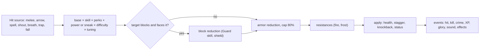
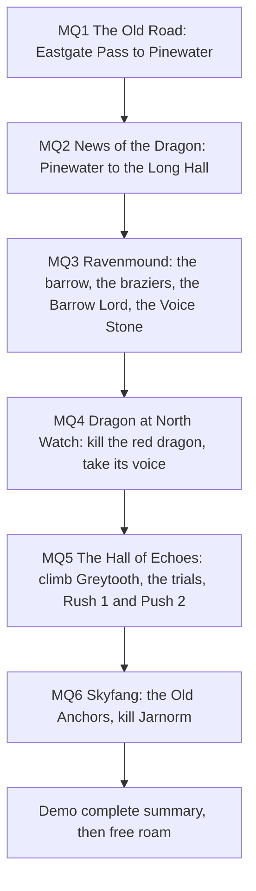
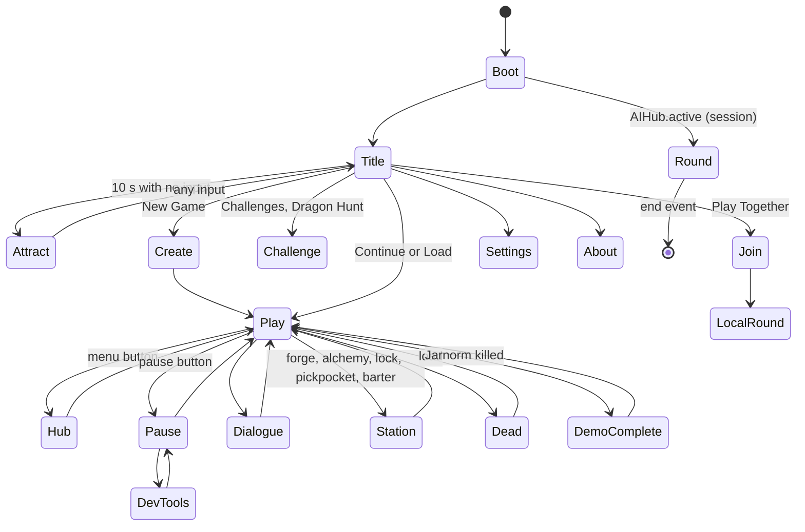
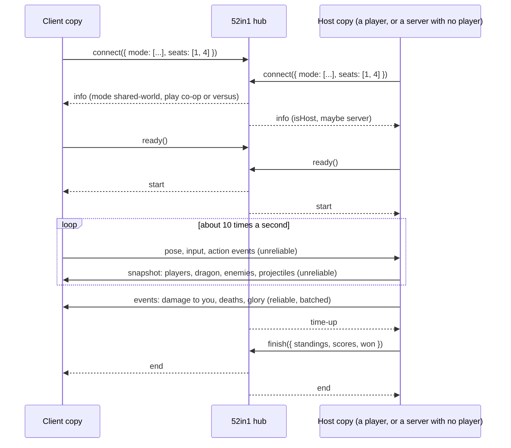
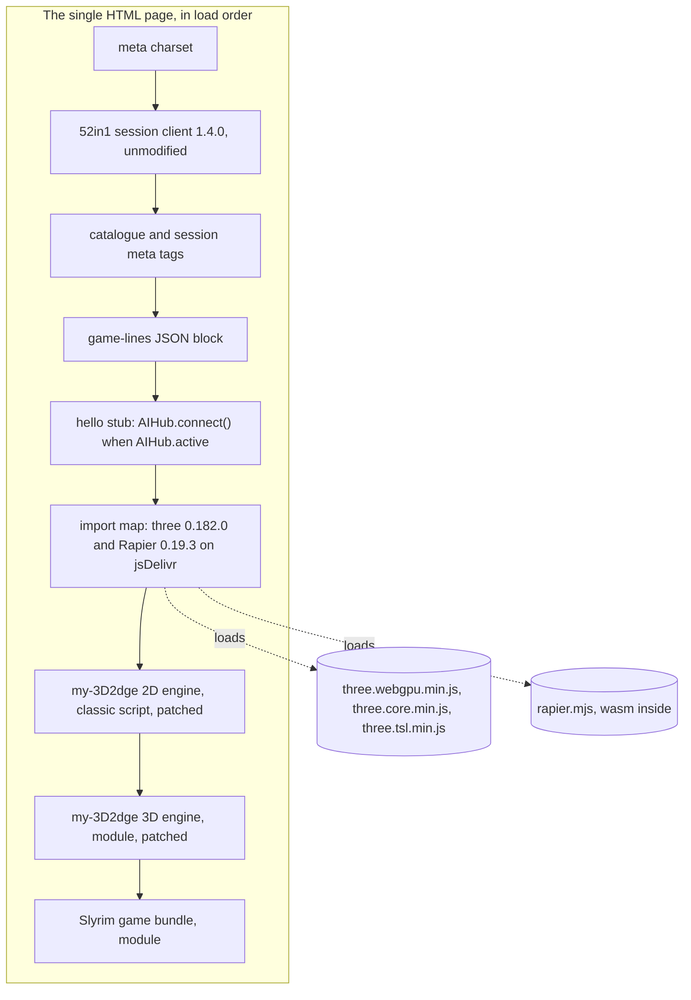
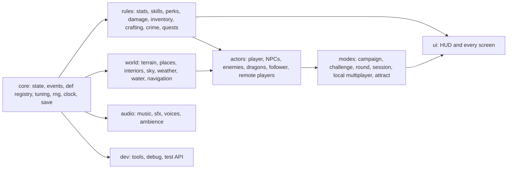

# SLYRIM: build plan and handoff

**From:** the lead architect and game designer (planning session).
**To:** the build agent (Codex CLI, OpenAI gpt-6.1-sol, reasoning effort max).
**Prepared:** 2026-11-16 (UTC). All research was checked live on 2026-11-15 between 23:30 and 23:59 UTC.
**Game:** *Slyrim*, an original open-world action RPG inspired by *The Elder Scrolls V: Skyrim*.
**Deliverable file:** `Slyrim-Skyrim-ESV-gpt-6.1-sol-max-20261115-152129.html`.

This one file is the whole handoff. It holds the original prompt word for word (Part B), every decision that is already
made, the research behind them, the full game design, the architecture, the test plan, the package steps and the
templates for the About/Credits screen and `exit-interview.json`. You do not need anything else from the planning
session. The "images" for this plan are inside it as Mermaid diagrams, ASCII maps and wireframes, data tables and an
SVG icon, so nothing is lost when the file moves.

---

## Contents

- [Part A. How to use this plan](#part-a-how-to-use-this-plan)
- [Part B. The original prompt (verbatim)](#part-b-the-original-prompt-verbatim)
- [Part C. Decisions at a glance](#part-c-decisions-at-a-glance)
- [Part D. Requirements traceability](#part-d-requirements-traceability)
- [Part E. Research findings (verified)](#part-e-research-findings-verified)
- [Part F. Game design](#part-f-game-design)
- [Part G. Content](#part-g-content)
- [Part H. UX and UI (10-foot, controller-first)](#part-h-ux-and-ui-10-foot-controller-first)
- [Part I. Art direction](#part-i-art-direction)
- [Part J. Animation](#part-j-animation)
- [Part K. Audio](#part-k-audio)
- [Part L. Multiplayer](#part-l-multiplayer)
- [Part M. Attract mode](#part-m-attract-mode)
- [Part N. Dev mode](#part-n-dev-mode)
- [Part O. Languages](#part-o-languages)
- [Part P. Technical architecture](#part-p-technical-architecture)
- [Part Q. Packaging, catalogue and PACKAGE](#part-q-packaging-catalogue-and-package)
- [Part R. Testing](#part-r-testing)
- [Part S. Build order and milestones](#part-s-build-order-and-milestones)
- [Part T. Risks and mitigations](#part-t-risks-and-mitigations)
- [Part U. Definition of done](#part-u-definition-of-done)
- [Part V. Templates (About/Credits, exit interview, chat reply)](#part-v-templates-aboutcredits-exit-interview-chat-reply)
- [Appendices](#appendices)

---

## Part A. How to use this plan

1. **Precedence.** The prompt in Part B is the contract. If this plan and the prompt disagree, the prompt wins. The live
   52in1 documents (`https://52in1.com/lib/hub/README.md`, `catalogue.md`, `languages.md`) win over my summaries of
   them in Part E. This plan wins over the engine's own guides where they conflict with the prompt (example: the engine
   says a 3D game ships as a served folder; the prompt says one HTML file, and Part E.2 shows how).
2. **Already decided. Do not re-decide.** The title (picked with a real RNG, Appendix A), the file and folder names,
   genre, perspective, the list of multiplayer modes, the catalogue metadata strings, the world, story, names and the
   feature list. Change one only if it breaks a hard requirement, and then say so in your chat reply.
3. **Yours to decide.** Code structure inside the architecture of Part P, algorithms, exact level geometry, art details,
   music, and every starting number in the data tables. The numbers here are starting values. The prompt says tuning
   is not required; human testers tune with the dev sliders (Part N).
4. **Scope rule.** The prompt forbids TODOs, placeholders and stubs. If time runs short, remove a whole feature (its
   menu entry, its lines, its data) instead of shipping half of it. Part S gives the order, so the core is finished
   first. Part U is the checklist you finish against.
5. **Reading order.** Part B, C, E, then F to O as you build each system, then P to U.

---

## Part B. The original prompt (verbatim)

The text below is the prompt exactly as the user gave it to the planning session. "This computer" describes the build
agent's machine, not the planning machine.

````text
SOURCE: Skyrim (ESV)

Genre: Pick the game genre(s) that best fit the source and would make the best game.

Perspective: Pick the camera perspective(s) that best fit the genre and source and would make the best game.

Game Title: A playful riff on SOURCE's name. Silently brainstorm 50 titles, then pick one with a real random number generator (e.g., run code).

Research: Whether and how much to research is your choice.

Package: For ease of deployment and sharing provide a single html file [GameTitle-SOURCE-gpt-6.1-sol-max-20261115-152129].html with everything the game needs in it. The only exception is three.js and Rapier, which may load from a CDN at a version the AI Hub Catalogue allows.

Tech Stack: Build on https://github.com/michaelcrosato/my-3d2dge/tree/main/dist/handoff. You may change anything in it, the engine included, and add whatever systems, art assets and animations the game needs. The rest of the tech stack is your choice.

Art Direction: Use the engine’s native style as the base. Make new art assets for whatever makes the game feel like the source; the engine’s asset library is fine for generic props.

Animation: Animation technique and implementation is your choice.

Audio: All music, sound effects and voices are written in code, with no audio files. Voices are Animalese/Simlish-style gibberish. Music is to be set to 10% volume by default.

Working Environment and deliverable:
Create a subfolder called [GameTitle-SOURCE-gpt-6.1-sol-max-20261115-152129] to keep all your dev files in. You can develop separate modules, then bundle into a single file [GameTitle-SOURCE-gpt-6.1-sol-max-20261115-152129].html in root when you’re done. Do not read files outside what you need: other agents work in the folders beside this one. They share this machine’s ports and processes too. Prefer file:// and the engine’s headless tools. If you need a server (the AI Hub harness does), bind 127.0.0.1 on a port the OS picks (`python3 -m http.server 0 --bind 127.0.0.1` prints it) and confirm the page is your game before trusting a result. Stop only processes you started, by their PID: never pkill, killall, fuser -k, or kill whatever holds a port.

Performance: Treat the performance budget as unlimited. Add as much detail, enemies, effects, lights, and shadows as the scene needs. Out of scope (handled later): FPS targets, optimization.

Testing: Use headless tools: scripts that play the game and check its state, including a scripted playthrough of the whole game. Keep them behind one command that prints only failures and a one-line count, and rerun it only after changing the code it covers. Use screenshots only for what a script can’t check. Don’t use subagents or workflows to debate, review, judge or audit.

Effort: Spend effort however you see fit.

## This computer
Checked 2026-11-09 08:09 (America/Vancouver) by node check-environment.mjs.

- **Computer:** IVY-DESK-1747k: Intel(R) Core(TM) i7-14700F, 20 cores, 20 GB RAM, 8 GB swap. Ubuntu 26.04.1 LTS on WSL2 (Linux 6.18.33.2-microsoft-standard-WSL2).
- **Space:** 731 GB free in the home folder. /tmp: 9.8 GB, in memory (tmpfs), 8.4 GB free when checked.
- **Display:** none for runs (they run with DISPLAY unset), so a headed browser needs xvfb-run.
- **Browsers:** Playwright 1.63.0 for Python (from playwright.sync_api import sync_playwright), with Chromium 153.0 (WebGL 2, software-rendered; WebGPU, software-rendered, when started with --enable-unsafe-webgpu --enable-features=Vulkan --use-webgpu-adapter=swiftshader --use-vulkan=swiftshader --use-angle=swiftshader), Firefox 155.0 (no WebGL), WebKit 26.6 (WebGL 2) already downloaded. Phone and tablet device profiles are built in.
  Run scripts that use it with `~/.local/share/pipx/venvs/playwright/bin/python`, the Python it's installed in: python3 can't import it.
  WebGPU only works on a secure page: file:// or http://127.0.0.1. Use those flags only for WebGPU games: with fewer, the device is lost as the game starts or its 3D picture comes out blank in a screenshot, and on a page that doesn't use WebGPU they can slow a screenshot past 30 s.
  For Node, `npm install playwright@1.63.0` in your folder uses the browsers already downloaded; another version downloads its own.
- **Tools:** node 24.21.0, npm 12.1.0, python3 3.14.4, pip3 25.1.1, git 2.53.0, gh 2.101.0, curl 8.18.0, wget 1.25.0, jq 1.8.1, ffmpeg 9.0.2, ffprobe 9.0.2, sqlite3 3.50.6, zip 3.0, unzip 6.00, rustc 1.98.1, cargo 1.98.1, go 1.27.1, java 21.0.12, xvfb-run, magick 7.1.2, sox 14.4.2, bun 1.3.14, deno 2.9.7, uv 0.12.18, tsc 5.9.3, wasm-bindgen 0.2.129.
- **Rust:** rustup's toolchains 1.98.1, stable; the wasm32-unknown-unknown target on 1.98.1, stable.
- **Not installed:** lighthouse, shot-scraper, esbuild.
- **Network:** internet works (github.com, registry.npmjs.org).

### What this computer doesn't have

No script can check these, so they're written by hand. Test with the stand-ins; anything that needs the real thing is checked as far as it can be here, never required.

- **No physical controller.** Emulate one: replace navigator.getGamepads with a stub that returns a pad in the standard mapping (Playwright's add_init_script / addInitScript).
- **No touch device.** Use Playwright's phone and tablet profiles, which have touch, and tap with page.touchscreen.
- **Nobody to listen.** Check sound by what Web Audio produces: render it with an OfflineAudioContext, or read levels from an AnalyserNode.
- **No second player.** Play multiplayer with two browser pages (or contexts) on this computer.
- **No real iPhone or iPad.** WebKit with an iPhone profile is the closest; it isn't iOS Safari.
- **No TV.** Judge the 10-foot view from screenshots at 1920×1080.

### Sharing this computer

- Other agents run here at the same time. Keep one or two browsers open at once, and close them when you're done.
- Keep every file you make inside your own folder, not /tmp or a parent folder: /tmp is shared.
- The browsers are already downloaded: don't run `playwright install` or `playwright install-deps`.
- Playwright's Python (`~/.local/share/pipx/venvs/playwright/bin/python`) has Playwright and nothing else. For one (Pillow, numpy …), use uv: `uv run --with pillow python script.py`, adding `--with playwright==1.63.0` when the script drives a browser too (a newer Playwright can't find the browsers here).

## Goal

Build an original game inspired by the source.

Scope

Create a feature-complete demo. Capture what makes the source distinctive (its world, characters, themes and tone) and turn it into the mechanics, pacing and UX of a great game. The demo must be long enough to show ALL features and gameplay mechanics so a player can clearly understand how the game plays and feels, and what they can and cannot do. Treat the demo as a complete, polished vertical slice. It should contain all the infrastructure, systems, and polish needed so the remainder of the game could later be built out with normal designer tools.

Include a dev mode, reachable from the pause menu, with the standard tools for testing the game quickly. Balance is key, so expose the most important gameplay variables as live sliders, with a reset to defaults.

Gameplay tuning and balancing the game is not a requirement. Human testers will fine tune difficulty, mechanics and the overall player experience. The dev mode settings will allow players to tune the game.

Attract Mode: After 10 seconds without input on the title/menu screen, start a looping AI-played demo or scripted replay (arcade/kiosk style); any input exits it. The AI (or replay) can be simple and may cheat freely (infinite health, ammo, abilities, no clip, etc). Its only job is to show as much of the demo as possible, the attract mode is not meant to balance the game.

Multiplayer: Support 52in1 sessions: follow https://52in1.com/lib/hub/README.md and pass the harness check in each online mode. Parallel is required, and ghost too when the game allows it. Also add these when the game can support them. Online: shared-world co-op and versus. On one device: same-screen co-op and versus, and split-screen co-op. List every mode in hub:multiplayer. Each mode should extend the core game, not reshape it, unless the core game is multiplayer.

Narrative tone: Use a blunt, functional, writing style governed by ASD-STE100 rules. Write short, active sentences with plain vocabulary. No metaphors, banter, or dramatic flair, prioritize immediate clarity and strict economy of words. Avoid idioms and puns. The game’s title is the one exception: it can riff on the source’s name.

## UI & UX: 10-Foot Controller-First Philosophy
Design the game around a PS5 DualSense (or any pad the browser reports in its standard mapping) played on a TV at 10 feet. With keyboard and mouse it's the same game on the same screens, not a separate desktop layout, but they should feel native, not like stand-ins for controller buttons. The keyboard uses the keys PC players expect for the genre. The mouse aims, looks, and clicks menu items and things in the world (hover moves the focus) wherever the genre uses it. On-screen prompts follow the input used last: PlayStation glyphs for the controller (with a Settings option to show Xbox glyphs, A B X Y, instead), keys and mouse buttons for keyboard and mouse.

Do not use overly dense, web-style data screens.

Touch-only devices: no touch controls; show "Controller or keyboard required" and the settings button. Let the attract mode run.

52in1: Make the game ready for translation. Follow https://52in1.com/lib/hub/languages.md (AI Hub Languages v1). Don't translate unless this prompt asks for translations. If the game engine provided already supports this, you can ignore this step (such as my-3d2dge).

Prepare this game for 52in1.com. Follow https://52in1.com/lib/hub/catalogue.md (AI Hub Catalogue v1): hand in the package it describes, and pass its checker. Put the package in a folder called PACKAGE beside the game's .html.

## Done
No TODOs, placeholders, or stubbed features. The demo is complete.

## Source Information
CRITICAL: Put Source Information, Testing Feedback, Engine Feedback and Prompt Feedback in your chat reply and an in-game About/Credits screen. Write "unknown" for anything you can't confirm.
- Date: 2026-11-15 15:21:29
- Source: the work it's based on
- Plan: the file name of the plan you were given to build from, or none
- Genre and Perspective: genre and camera perspective used
- Tech: stack, libraries/engines, with versions if applicable
- Art Direction: style used
- Animation: system used
- Audio: music, sound effects and voice used
- Online: network features used, or none
- Testing: testing parameters allowed
- Research: research done, or none
- Environment: Codex CLI (headless); Linux
- Model: OpenAI, gpt-6.1-sol, reasoning effort max
- Usage: write "added on import". You can't see your own cost, so don't estimate it: the runner records the real cost, tokens and time, and the agent that imports the game into 52in1 puts them on your About/Credits screen.

Exit interview: before you finish, also save these answers as exit-interview.json in this folder's root, beside the game's .html: one JSON object in exactly the shape below, every value filled in ("unknown" for anything you can't confirm). Tools read it (the game's run record and the 52in1 catalogue), so write plain text, and check that the file parses as JSON.
{
  "sourceInformation": {"date": "", "source": "", "plan": "", "genre": "", "perspective": "", "tech": "", "artDirection": "", "animation": "", "audio": "", "online": "", "testing": "", "research": "", "environment": "", "model": "", "usage": "added on import"},
  "testingFeedback": ["your answer to each Testing Feedback question, in order"],
  "engineFeedback": ["your answer to each Engine Feedback question, in order"],
  "promptFeedback": ["your answer to each Prompt Feedback question, in order"],
  "aiHub": {
    "name": "the game's title, as on its title screen",
    "tagline": "a few words to go under the title",
    "description": "one or two sentences for the catalogue",
    "type": "Game, Tech demo or Tool",
    "genre": "one of Action, Adventure, Fighting, Flight, Horror, Kids & Learning, Life Sim, Platformer, Puzzle, Racing, RPG, Shooter, Simulation, Sports, Stealth, Strategy",
    "source": "the work it's based on, e.g. Moby-Dick",
    "series": "its franchise, e.g. Star Fox, or empty",
    "players": "how many play at once, as the catalogue's hub:players: MIN-MAX like 1–4 or 2–8, or 1 when it plays together only in parallel or not at all",
    "controls": "the controls, in one line",
    "tags": ["2 to 5 tags from the catalogue's lists, written exactly as there, e.g. 2d, 3d, arcade, story, co-op, versus, first-person, third-person, top-down, side-scrolling, pixel art, low-poly, retro, sci-fi, fantasy, comedy, vehicles, boss fights, exploration"]
  }
}
The catalogue's model, effort, CLI, date and usage come from the run's record after you finish, so they aren't asked here.

Testing Feedback

- What was the most helpful test you ran?
- What was the least helpful test you ran?

Engine Feedback

- What did you like most about the engine?
- If you could change one thing about the engine, what would it be?

Prompt Feedback

- Was there anything confusing about the prompt?
- What would you change in this prompt?
````

---

## Part C. Decisions at a glance

| Item | Decision |
| --- | --- |
| Title | **Slyrim** ("sly" + Skyrim). Picked from 50 brainstormed riffs with `secrets.randbelow(50)` (Appendix A). Do not re-roll. |
| Title screen line (tagline) | "A northern open-world RPG" |
| SOURCE in file names | `Skyrim-ESV` (from "Skyrim (ESV)": letters, digits and hyphens only, as the catalogue requires) |
| Dev subfolder | `Slyrim-Skyrim-ESV-gpt-6.1-sol-max-20261115-152129/` |
| Final game file (root) | `Slyrim-Skyrim-ESV-gpt-6.1-sol-max-20261115-152129.html` |
| Package | `PACKAGE/games/Slyrim-Skyrim-ESV-gpt-6.1-sol-max-20261115-152129.html` and `PACKAGE/covers/slyrim-skyrim-esv-gpt-6-1-sol-max-20261115-152129/{0,1,2}.jpg` |
| Genre | Open-world action RPG with a strong stealth and theft layer. Catalogue genre: `RPG`. |
| Perspective | Third person over the shoulder by default, first person on a toggle (R3 / F), both complete. Same-screen local play uses a high shared chase camera. |
| Engine | my-3D2dge **v0.101.0** (commit `d88bb9d74385ce372ac1e608096b57750b3db092`), 2D engine plus the 3D engine (`E.World3D`) |
| Libraries | three.js **0.182.0** (WebGPURenderer, WebGL 2 fallback) and Rapier **0.19.3** (`@dimforge/rapier3d-simd-compat`) from jsDelivr. Both on the hub's allowed list. Verified to load from `file://` (Part E.2). |
| Art direction | The engine's native 3D look: a real 3D world drawn at a low pixel resolution with procedural nearest-neighbour textures, fog, torchlight and shadows; characters as the engine's pixel-art rigs on cards (HD-2D style); dragons and set pieces as chunky low-poly models drawn with the engine's pen. Cold palette, warm firelight, aurora nights. |
| Animation | Procedural: engine Humanoid rigs with `E.MOVES`, custom procedural skeletons (dragon, wolf, spider, troll, giant), IK feet, first-person arms on the overlay pen, tweens and scripts for set pieces. |
| Audio | All Web Audio code: music as note data on the engine's synth plus formant "choir" voices; synthesized SFX; syllable-driven gibberish voices; music volume 10% by default. |
| Writing | ASD-STE100 style for every in-game line (Part G.8). The title is the only riff. |
| Online modes | `parallel 1-4`, `ghost 1-4`, `shared-world co-op 2-4`, `shared-world versus 2-4`, all on one round: **Dragon Hunt** at North Watch. |
| One-device modes | `same-screen co-op 2-4`, `same-screen versus 2-4`, `split-screen co-op 2-4`, on the same Dragon Hunt round, from the title's Play Together menu. |
| Single player | The campaign demo (six main quest steps, eight side quests) plus the Dragon Hunt challenge (best time). |
| Attract mode | Autopilot tour of the real game with cheats on, after 10 s idle on any title screen. |
| Dev mode | Pause menu, Dev Tools: cheats, spawn, travel, quest control, debug views and about 30 live tuning sliders with Reset. |
| Languages | The engine already follows AI Hub Languages v1. Every word is a line (`E.t`), `game-lines` block in the head, English only, the three test languages pass. |
| Catalogue | `hub:genre` RPG; `hub:tags` `action-rpg, open world, fantasy, stealth, co-op`; `hub:source` `The Elder Scrolls V: Skyrim`; **no `hub:series`** (Part E.4 explains); `hub:model` `GPT-6.1 Sol`; `hub:effort` `max`; `hub:harness` `Codex`. |
| Icon | A frost-white fox head over a dark wing, on night blue `#1b2a40` (Appendix E). |

---

## Part D. Requirements traceability

Every requirement of the prompt, where this plan answers it, and how it is proven. "Test" means a script in the one
test command (Part R). "Look" means a screenshot you check by eye.

| # | Requirement (prompt) | Plan | Proof |
| --- | --- | --- | --- |
| 1 | Original game inspired by Skyrim; capture world, characters, themes, tone | F.1, F.3, G | Look; playthrough test |
| 2 | Genre and perspective chosen | C, F.6 | Test: camera toggle |
| 3 | Title riff, 50 brainstormed, real RNG | C, App. A | Done in planning |
| 4 | Single HTML; only three.js and Rapier from an allowed CDN | E.2, Q | Test: page scan for network use; catalogue checker |
| 5 | Build on my-3d2dge handoff; engine may change | E.1, E.7, P | Engine patch list in chat reply |
| 6 | Engine native style plus new art for the source's feel | I | Look |
| 7 | Animation technique free | J | Filmstrips of attacks |
| 8 | All audio in code; gibberish voices; music 10% default | K | Test: no audio files; `audio.musicVolume === 0.1` on first boot; OfflineAudioContext render of a voice line is not silent |
| 9 | Dev subfolder; bundle to one file in root; folder hygiene; server rules; PID-only kills | P.1, P.2, R.5 | Process log |
| 10 | Performance unlimited | (no work) | Hub deadlines still apply (E.3) |
| 11 | Headless tests incl. full scripted playthrough; one command; failures plus a one-line count | R | The command |
| 12 | Feature-complete demo showing all mechanics; vertical slice; designer-ready infrastructure | F, G, P.4 | Playthrough test; data-driven content |
| 13 | Dev mode in the pause menu, live sliders, reset | N | Test: slider changes a value; reset restores |
| 14 | Attract mode after 10 s idle; any input exits; loops | M | Test: idle 10 s starts it; a key ends it |
| 15 | 52in1 sessions; harness pass in each online mode; parallel and ghost; shared-world co-op and versus | L | Test: harness in every mode and player count |
| 16 | Same-screen co-op and versus; split-screen co-op; listed in `hub:multiplayer` | L.1, L.7 | Test: two emulated pads |
| 17 | ASD-STE100 tone | G.8 | Test: line linter (length, banned words) |
| 18 | 10-foot, controller-first UI; native keyboard and mouse; hover focus; prompts follow last input; PS glyphs default, Xbox option | H | Tests with emulated pad; looks at 1920×1080 |
| 19 | No dense web-style screens | H.1 | Look |
| 20 | Touch-only: no touch controls, the required message and Settings button, attract runs | H.7, E.7 | Test with a phone profile |
| 21 | Ready for translation | O | `tools/lines.mjs --check`, `lines-scan` in en-XA |
| 22 | Catalogue package and checker pass; PACKAGE beside the HTML | Q | Checker output |
| 23 | No TODOs or stubs | A (item 4), U | Test: grep for TODO, FIXME, placeholder, "coming soon" |
| 24 | Source Information and feedback in chat and About/Credits | V | Test: About screen lines exist |
| 25 | `exit-interview.json`, exact shape, parses | V.3 | Test: JSON shape check |

---

## Part E. Research findings (verified)

### E.1 The engine: my-3D2dge v0.101.0 handoff

Source: `https://github.com/michaelcrosato/my-3d2dge/tree/main/dist/handoff`, reviewed at commit
`d88bb9d74385ce372ac1e608096b57750b3db092` ("v0.101.0", 2026-11-15). Pin to this commit (Part S, M0).

What is in the folder:

| Path | What it is |
| --- | --- |
| `my-3d2dge.js` (1.35 MB) | The full 2D engine, readable, with every module. It runs every game, 3D included: fixed 1/120 s steps, scenes, input, the standard pause menu, settings, rebinding, saves, sound, rigs, HUD, `E.Shell`, languages. Load it first, as a classic script. |
| `my-3d2dge-3d.js` (281 KB) | The 3D engine (`E.World3D`), an ES module. **Its header (lines 1 to 266) is the 3D manual: read it whole.** It imports `three/webgpu`, `three/tsl` and `@dimforge/rapier3d-simd-compat`. |
| `API.md` | The API card. Read it whole. |
| `API-INDEX.md` | Every public 2D name, one line each. Search it, do not read it. |
| `AI_GUIDE.md` | Recipes, look rules, sessions, checklist. Search it. |
| `docs/ASSETS.md`, `docs/LANGUAGES.md` | Assets as data; languages (AI Hub Languages v1). |
| `kits/3d-shooter.js` | **Best base for the open world:** a 2 km streamed terrain, first and third person, compass bar, climbing and mantling, sway grass, streamed trees and rocks, first-person arms and weapons on the overlay pen. |
| `kits/3d-action.js` | Melee: `E.Combo`, dashes, lock-on (`camera.lock`), telegraphed enemy swings, waves, Rapier crowds, breakable props. |
| `kits/3d-horror.js` | `E.RPG` inventory, keys and locked doors, `world.through` door transitions, item box, saves. |
| `modules/story.js` | `E.Story`: dialogue nodes with choices, conditions, flags, a quest log, balloons. Use it for dialogue. |
| `modules/rpg.js` | `E.RPG`: JRPG stats and slot or grid bags. Its rules do not match a weight-based RPG. Use it only where it fits (shop helper). |
| `modules/songs.js` | `E.Songbook`: songs by mood, jingles. |
| `tools/check.mjs`, `filmstrip.mjs`, `replay.mjs`, `lines.mjs`, `lines-scan.mjs`, `asset-find.mjs`, `asset-sheet.mjs` | The engine's headless tools. They serve module pages on `127.0.0.1` with an OS-picked port (`listen(0, '127.0.0.1')`), which meets the prompt's server rule. |
| `package.json` | Pins `playwright` **1.63.0**, the version installed on the build machine. Run `npm install` there. **Do not run `npx playwright install`** even though the handoff README says so. |
| `vendor/` | three r182 and Rapier 0.19.3 copies. You will not ship these; the page loads the same files from jsDelivr. |

Engine facts that shape the design:

- Units: 16 units = 1 metre = 1 tile; x east, y south, z up; angles from +x toward +y. Game logic in world units.
- 3D game shape: `new E.Game({ canvas: 'screen', res: 'ps1', expand: true, bg: null, input, menu })`, then
  `await E.World3D.init(game)` in a boot step, then `new E.World3D(game, { terrain | level, ... })`. In a scene:
  `update(dt) { rules; world.step(dt) }`, `draw(r) { world.draw(r); HUD }`.
- Open worlds: `terrain: { size, height(x, y), color(x, y, z, nz, out), cell, chunk, far, rock, ... }`, streamed in
  chunks for physics and meshes. Keep `height()` fast.
- Interiors: text levels (`rows` plus `legend`: floors, walls, pillars, stairs, platforms, pits, torches, marks,
  shapes). `world.flow()` paths monsters in levels (on terrain it goes straight).
- Actors: `world.hero()` (kinematic capsule, Rapier character controller) and `world.mob()` (dynamic body). Rigs:
  `E.Humanoid` (outfits, hair, hats, armor, capes, `E.MOVES` attacks, poses, faces), `E.Blob`, orbs.
- Cameras: `view`, `chase`, `first`, `fly`, `fixed`, `zones`, `behind`; lock-on; `camera.takeMouse()`; first-person
  overlay pen for arms and weapons; split screen with `game.splitScreen(n)` and `world.addCamera()`.
- Things: `world.thing(kind)` (chest, door with locks, lever, key, potion, tree, rock, crystal...), `world.shape(id)`
  for about a thousand library props (pines, snowy firs, rocks, anvil, coffins, crypts, pillars, statues, obelisks,
  campfires, tents, beds, tables, barrels, banners, wells, carts, logs, fences), `world.crate/barrel/box` physics
  props, `world.knock()` to throw one.
- Look settings the player can change (`E.World3D.SETTINGS`): characters as cards (default) or puppets; 3D picture
  pixels (default), balanced or full; shadows; filter clean, comic cel or pixel.
- Standard features you must not rebuild: pause menu, settings, controls and rebinding (with button-symbol choice),
  full screen, save slots (`game.saves`), boot screen and crash report, pausing on hidden page or lost pad,
  `touch: 'never'` handling, player join (`game.allowJoin`), language choice.
- Determinism: fixed steps; `world.reset()` plus the same inputs give the same `world.hash()`. Use `E.rng(seed)` for
  gameplay randomness, seeded from the session seed in online rounds.

### E.2 Single-file 3D packaging: verified spike

The engine's README says a 3D game "stays a folder, served". The prompt needs one HTML file. In planning I built a
throwaway page from `game3d/index.html` with: the import map pointed at jsDelivr, the 2D engine inlined as a classic
script, the 3D engine and the game inlined as `type="module"` scripts, and every `</script` inside them written as
`<\/script`. Results in headless Chromium:

- Opened from **`file://`** with `?backend=webgl`: booted in about 5 s, drew the 3D room with torches and the hero,
  no console errors. The open-world shooter kit built the same way booted in about 11 s, the 3D action kit in about
  10 s (the planning machine, a cloud container, software WebGL; your machine will differ). A full open world is far
  over the session budget of Part L.4, so the session round must use the lean world.
- The CDN files are byte-identical to the engine's `vendor/` copies:
  `three@0.182.0/build/three.webgpu.min.js` 616,351 B; `three.core.min.js` 380,922 B (imported by the WebGPU build);
  `three.tsl.min.js` 23,117 B; `@dimforge/rapier3d-simd-compat@0.19.3/rapier.mjs` 2,308,827 B.
- One console **warning** (not an error) comes from inside Rapier 0.19.3's compat build: "using deprecated parameters
  for the initialization function; pass a single object instead". It is harmless. Leave it, or test Rapier 0.20.0 or
  0.21.0 (also allowed) only if the engine runs unchanged on them.

Use exactly this import map (keys as the 3D engine imports them):

```html
<script type="importmap">{ "imports": {
  "three": "https://cdn.jsdelivr.net/npm/three@0.182.0/build/three.webgpu.min.js",
  "three/webgpu": "https://cdn.jsdelivr.net/npm/three@0.182.0/build/three.webgpu.min.js",
  "three/tsl": "https://cdn.jsdelivr.net/npm/three@0.182.0/build/three.tsl.min.js",
  "@dimforge/rapier3d-simd-compat": "https://cdn.jsdelivr.net/npm/@dimforge/rapier3d-simd-compat@0.19.3/rapier.mjs"
} }</script>
```

Inlining rules for the build script:

1. Replace every `</script` (any case) inside inlined code with `<\/script`. The 3D engine's header alone has four.
2. Replace every `<!--` inside inlined code with `<\!--` (an HTML parser treats it specially inside script data).
3. Keep module order: 2D engine (classic) → 3D engine (module) → game (module). Non-async inline modules run in
   document order after parsing, so the game module always sees `E.World3D`.
4. In the `game-lines` block write `<` as `<` (Languages v1).

### E.3 52in1 sessions: AI Hub Session Protocol v1 (client 1.4.0)

Read the live page before you build: `https://52in1.com/lib/hub/README.md`. Summary of what matters here:

- **Client.** Paste `https://52in1.com/lib/hub/session.js` **unmodified** as the first script in `<head>`, right
  after `<meta charset>`. In a session it seeds `Math.random` (parallel and ghost), gives the page empty storage and
  takes over full screen. Outside a session it does nothing.
- **Joining.** `AIHub.active` is true from the first line in a session. Then the game opens straight into the round:
  no title, menus or prompts. Call `AIHub.connect({ mode: ['parallel', 'ghost', 'shared-world'], seats: [1, 4] })`
  (it resolves to the round's `info`, or `null` when there is no hub), load, then call `AIHub.ready()` once with no key
  press. Use the hub's own card (do not pass `card: true`).
- **`info`:** `me`, `players [{ id, name, color }]`, `host`, `isHost`, `server` (a host with no player),
  `mode`, `round`, `limitMs`, `play` (`co-op`, `versus`, `other` or `null`), `seed`. Seat colours `#e8443a`,
  `#3b82f6`, `#22c55e`, `#f5b700`. Names are text, never HTML.
- **Start.** `start` arrives; play begins 3 s later when `AIHub.time()` reaches 0 (`-Infinity` before start).
- **Reporting.** Parallel and ghost: `AIHub.progress({ score, label })` about once a second, then
  `AIHub.result({ time })` or `AIHub.result({ score })` once. Shared world: the host calls
  `AIHub.finish({ standings, scores, won })` once.
- **End.** On `time-up` report within `graceMs` (5 s). After `end` take no input, send nothing, stop the sound.
- **Messages.** `AIHub.send(data, { to, reliable })`, JSON, at most 16 KB; **at most 20 messages a second per copy**
  (bursts to 40); unreliable messages over about 1,200 bytes travel as several packets and are lost whole if one is.
  `AIHub.on('message', (data, from) => ...)`. Use `AIHub.rng(label)` for numbers that must match across copies.
- **Rules in a session.** Network only through the hub. No chat, emotes or custom names. No `alert`, `confirm`,
  `prompt`, `window.open`, navigation. Quit, restart and return-to-title do nothing. Leave PS (button 16) alone and
  ignore Options while Create is held (the engine already does).
- **Harness** (`harness.html`, `bridge.js`, `round.js`, served next to the game, same origin):
  `harness.html?game=GAME.html&players=N&auto=1`, plus `&mode=shared-world&how=co-op|versus`,
  `&scenario=host-leave|server`, `&latency=150&jitter=50&loss=5`, `&limit=` and `&seed=`. Pass means
  `window.__hubCheck.pass === true`; `document.body.dataset.complete` becomes `"true"` at the end. The hub's own check
  plays parallel at 1 and 2 players and the other modes at 2, 3 and 4, on a poor network, once with a player leaving
  and (shared world) once with `scenario=server`, for **every** online mode `hub:multiplayer` names.
- **Harness deadlines (from `round.js` and `harness.html`, client 1.4.0):** every copy must say hello (call
  `connect()`) within **10 s** of loading; every copy must call `ready()` within **20 s** after the hellos; the
  countdown is 3 s; after `time-up` the result or finish must arrive within **5 s**. The auto run presses random
  arrows and WASD inside each frame for a few seconds, removes a player (3 or 4 players, or the host with
  `host-leave`), then calls time.
- **Why this is the top technical risk:** the harness frames are same-origin, so all copies share one browser main
  thread. Four copies boot one after another. If one copy needs 8 s of main-thread work to boot, four need 32 s and
  "ready without a key press" fails. Part L.4 sets a boot budget and the design to meet it.
- **Failures seen on the wall** for other my-3D2dge games (from `games.json`): "ready without a key press",
  "no errors, dialogs, popups or sockets", "every copy says hello; no client warnings", "game traffic flows both
  ways", "progress before welcome". The client warns (and the check fails) on: send or progress or ready before the
  welcome, more than 20 messages a second, messages over 16 KB, a result with no finite `time` or `score`, `finish`
  from a non-host.

### E.4 Catalogue v1 and the wall

Read the live page: `https://52in1.com/lib/hub/catalogue.md`. Checker: `https://52in1.com/lib/hub/catalogue-check.mjs`
(Node 18+, no installs).

- **Package layout:** `PACKAGE/games/FILE.html` plus `PACKAGE/covers/SLUG/0.jpg, 1.jpg, 2.jpg`. FILE is letters,
  digits, hyphens (dots are accepted without a warning; the wall has many `gpt-6.1-sol` names). SLUG = the file name
  slugged: `slyrim-skyrim-esv-gpt-6-1-sol-max-20261115-152129`. One file game: at most 25 MiB.
- **Head order:** `<meta charset="utf-8">` in the first 1,024 bytes → the session client (first script) → viewport,
  `<title>`, description, theme-color, icon, the `hub:*` tags → session tags → the `game-lines` block → everything
  else. The catalogue's tags must come before every other script and style. The hub reads the first 512 KB.
- **Screenshots:** 640×480 baseline JPEG, quality 58: Playwright `viewport` 960×720, `deviceScaleFactor` 2/3,
  `type: 'jpeg', quality: 58`. `0.jpg` title or opening view; `1.jpg` and `2.jpg` play. From the finished game, its own
  language, outside a session, nothing over it but the game. No loading, blank, error or debug frames; no two alike.
- **In the hub:** the game gets the whole window at any shape (fill every edge, follow resizes); runs in a frame;
  shares `localStorage` with every other game, so keep your keys under your own prefix and **never call
  `localStorage.clear()`**; never touch `ai-hub:` keys; nothing from other sites except three.js and Rapier; read
  keys by `event.code`; follow `?lang=`; no console errors.
- **Browser check before handing in:** the game fills the window at 1600×900, 2100×900 and 1200×900;
  `?lang=en-XA`, `?lang=zh-XC`, `?lang=ar-XB` work; nothing errors.
- **Allowed CDN shelf** (from the checker): hosts `cdn.jsdelivr.net`, `unpkg.com`, `esm.sh`, `cdn.skypack.dev`,
  `ga.jspm.io`, `cdnjs.cloudflare.com`; three.js `0.180.0` to `0.186.1` (13 listed versions, 0.182.0 included);
  Rapier `0.19.3`, `0.20.0`, `0.21.0`.
- **What the checker scans in the page text:** script `src` or imports or `fetch` to other sites, `WebSocket`,
  `EventSource`, `RTCPeerConnection`, `sendBeacon`, CSS `url()` to other sites, `localStorage.clear()` /
  `sessionStorage.clear()`, `ai-hub:` keys, `top.location` / `parent.location` changes, `window.open`, `alert(`,
  `confirm(`, `prompt(` with a string. **The planning spike tripped one finding inside the engine itself:**
  `my-3d2dge.js` line 10834 (session replay) calls `localStorage.clear()`. Patch it (Part E.7).
- **The wall (52in1.com/data/games.json, 2,914 games on 2026-11-15):**
  - Source spelling: `The Elder Scrolls V: Skyrim` (two games use it).
  - **Series: the wall files that source with no series.** If the page sets `hub:series` to "The Elder Scrolls", the
    online checker fails with "the wall files The Elder Scrolls V: Skyrim under no series of its own: leave hub:series
    out". So: **no `hub:series` tag**, and `"series": ""` in the exit interview (same value as the page).
  - Model spelling: `GPT-6.1 Sol` (813 games). Harness spelling: `Codex` (235 games).
  - Names already used by other Skyrim-based games: "The Elder Rolls: Scone of Destiny", "The Older Scrolls:
    Skyreach". "Slyrim" is free.

### E.5 Languages v1

Read the live page: `https://52in1.com/lib/hub/languages.md`. The engine implements the engine side (`E.t`, plural
forms, `{key:action}` control tags, the Language menu, device-font fallback, RTL, the typewriter that reveals whole
graphemes at the original pace, the three test languages). The prompt says this step can be skipped for my-3d2dge; the
catalogue still requires the `game-lines` block, so in practice: every player-facing word is a line, the block is in
the head, `names` and `brief` are filled, and you do not translate. Details in Part O.

### E.6 The build machine and how to run things on it

From the prompt (Part B): WSL2 Ubuntu, i7-14700F, Node 24, Python 3.14, bun 1.3.14, deno 2.9.7, no esbuild,
Playwright 1.63.0 with Chromium 153 (WebGL 2 by SwiftShader; WebGPU only with special flags and only on secure pages).

- Node Playwright: `npm install` inside the copied handoff folder (it pins 1.63.0) or `npm install playwright@1.63.0`
  in your dev folder. Never `npx playwright install`.
- Python Playwright: `~/.local/share/pipx/venvs/playwright/bin/python`.
- Bundling: use **bun** (`bun build src/main.js --format esm --outfile build/game.js`) or a small concatenating build
  script. The game code reads three.js and Rapier through `E.THREE`, `E.TSL` and `E.RAPIER`, so the game bundle has no
  external imports.
- Tests run the WebGL 2 path (`?backend=webgl`). Do not add the WebGPU flags (they slow non-WebGPU pages).
- Keep one or two browsers open at once. Keep all files in your folder (not `/tmp`). Start servers on
  `127.0.0.1:0`, read the port they print, check the page `<title>` contains "Slyrim" before trusting a result, and
  stop only the PIDs you started.

### E.7 Engine gaps and required engine changes

The prompt lets you change the engine. Record each change and why; the Engine Feedback answers and the chat reply
mention them.

| # | Change | Why | Where |
| --- | --- | --- | --- |
| 1 | Session replay: replace `localStorage.clear()` with removal of the engine's own keys only (`my3d2dge:`, `lang:` prefixes) | Catalogue checker warning; shared hub storage | `my-3d2dge.js` near line 10834 |
| 2 | `touch: 'never'` notice: text from lines (`E.t`, `textContent`, not `innerHTML`); a centred panel, not an 88% opaque full-screen veil; the Settings button keeps working; the attract mode stays visible behind it | Prompt (touch-only rule and "let the attract mode run"); Languages (no hard-coded English) | `my-3d2dge.js` `Game.prototype._needSync` (about line 4391) |
| 3 | Day and night: a public `world.setSky({ top, horizon, ground, sun, haze })`, `world.setSun({ dir, color, intensity })`, `world.setAmbient([sky, ground, intensity])`, `world.setFog({ color, near, far })`; stars and an animated aurora band on the sky dome | Time of day, night sky | 3D engine sections 9 and 10 (`_skyDome`, `_sun`, `_ambient`, `_fog` exist privately) |
| 4 | 3D weather: snow and rain particles in world space around each camera, wind, settle on nothing (cosmetic) | The 2D `game.weather` does not draw in 3D | 3D engine section 10 |
| 5 | `pen.tri(a, b, c, color)` and `pen.quad(...)` primitives (double-sided) | Dragon wing membranes, banners, cloth | 3D engine section 4 |
| 6 | Water and ice surfaces for terrain worlds: a flat plane per lake or river segment with a TSL material (moving ripple for water, crack pattern and gloss for ice) | Frozen lake, river | 3D engine or game side through `E.THREE` |
| 7 | Gear on rigs: shields, bows, axes, maces, daggers, greatswords, hoods, fur collars, helmets with crests. Cards: register with `E.Humanoid.weapon()`, `.hat()`, `draw: { under, over }`. Puppets: attach pen parts at the hand, forearm and head joints each frame | The puppet look draws only swords, a helmet ball, armour plates and capes | 2D rig registries; 3D `humanParts()` or a game-side attachment pass |
| 8 | Input: keep the D-pad for menus but not for walking in play; bind the DualSense touchpad click (button 17) if the engine does not; a hold-to-charge helper for the shout | Controls in Part F.5 | `my-3d2dge.js` input section |
| 9 | Storage: create the game with `id: 'slyrim'` so its settings and saves use their own names; check every key the game writes starts with `slyrim:` or an engine prefix | Shared hub storage | game code |

If you keep the puppet option in Settings, change 7 must be complete for puppets. If not, remove the puppet option
from the Characters setting (cards stay the default) rather than ship puppets without gear.

---

## Part F. Game design

### F.1 Pillars

1. **Freedom with a sly edge.** Every obstacle has a loud way and a sly way: fight, sneak, steal, trick, shout or talk.
   The title promises the sly way, so it is always there and it is always rewarded (sneak attacks, a sleeping boss,
   a stolen key, a thrown voice).
2. **The north is cold and alive.** Snow, wind, fog on the lake at dawn, aurora at night, torches in the villages,
   people who work, eat and sleep, animals that run.
3. **The voice of the dragons.** Shouts are loud, physical and rare (cooldowns). Dragon fights are set pieces, and a
   dragon's death gives you its voice.
4. **You become what you do.** Skills rise when you use them. Levels and perks follow. No class is locked.
5. **Plain words, clear play.** Every line is short and plain (ASD-STE100). Every screen reads from a sofa.

### F.2 Core loops

- **Moment to moment (seconds):** see something (a ruin, a chest, an enemy, a plant) → choose how (sneak, fight,
  steal, cast, shout) → get a reward (loot, XP, a discovery).
- **Session (minutes):** take a quest → travel (discoveries on the way) → a dungeon or a fight → a reward → manage the
  character (equip, craft, sell, take a perk, unlock a word).
- **Demo arc (about 60 to 90 minutes):** a courier arrives in Hrimdal → a dragon attacks the road → the courier learns
  an old word in a barrow → kills a dragon and takes its voice → the Elders teach more → the courier kills Jarnorm,
  the old dragon → free roam continues with everything unlocked that the demo has.

### F.3 Setting and story (original, not Skyrim's)

Everything here is new: names, places, people, the dragon language, the plot. Do not use Bethesda names, places,
characters, races, books, quest names, music or the dragon language (no "Fus Ro Dah", "Dovahkiin", "Thu'um",
"Greybeards", "Whiterun", "Nord" and so on). Genre ideas (dragons, shouts as a mechanic, barrows with undead, skills
by use, standing stones) are fine.

- **The land:** Hrimdal, a cold valley in the far north, ringed by mountains. Pine forest, tundra, a frozen lake, a
  river from the eastern peaks, old burial mounds. People speak plainly and work hard.
- **The threat:** a thousand years ago the dragon **Jarnorm** went to sleep on **Skyfang Peak**. Now Jarnorm is awake,
  and its call wakes other dragons.
- **The power:** the **Old Voice**. Dragons speak words that move the world. Old **Voice Stones** carry words cut in
  runes. A person can read a word, but cannot use it until they take the voice of a dead dragon.
- **The player:** a courier with a sealed letter for the Reeve of Greystead. No name; the game says "you". The body
  type is the player's choice; no line depends on it.
- **The plot (in STE, as the game tells it):** "Dragons are back in the north. A dragon attacks the road. You live.
  You learn an old word in Ravenmound Barrow. You kill a dragon at North Watch. You take its voice. The Elders of
  the Hall of Echoes teach you to shout. You go to Skyfang Peak. You kill Jarnorm."

### F.4 Character creation

A short, controller-friendly screen with a live 3D preview (camera turns round the character in a torch-lit tent at
the pass). Six rows, each changed with left and right:

| Row | Options |
| --- | --- |
| Background | Warrior, Mage, Thief (Part F.12: starting skills and kit) |
| Body | A, B (two `E.Humanoid` builds and silhouettes) |
| Skin | 6 tones |
| Hair | short, long, braid, shaved, hood-only (5) |
| Hair colour | 8 colours |
| Clothes colour | 8 colours (applies to the starting outfit) |

Done → "Start". No typed name (sessions forbid custom names; a pad has no keyboard).

### F.5 Controls

Prompts always show the device used last (engine `input.label(action)`): PlayStation symbols by default for any pad,
Xbox letters if the player picks them in Settings, keys and mouse buttons for keyboard and mouse. Every binding is
rebindable on the engine's Controls screen. The keyboard map follows what PC players expect for this genre.

**Play: keyboard and mouse**

| Action | Keys |
| --- | --- |
| Move | WASD |
| Look | Mouse (a click captures the pointer; Esc frees it) |
| Right hand: attack, cast, draw bow | Left click (hold for a power attack or a full draw) |
| Left hand: block, cast, aim | Right click |
| Interact: talk, open, take, read (hold to carry a small object) | E |
| Jump | Space |
| Sprint (hold) | Left Shift |
| Sneak (toggle) | C or Left Ctrl |
| Shout (hold longer for more words) | Z |
| Ready or put away weapon | R |
| First or third person | F |
| Quick menu (favourites) | Q |
| Favourites 1 to 8 | 1–8 |
| Drink the best healing potion | H |
| Menu hub | Tab |
| Items / Magic / Skills / Map / Quests | I / P / K / M / J |
| Wait | T |
| Quick save / Quick load | F5 / F9 |
| Pause | Esc |
| Camera distance (third person) | Mouse wheel |

**Play: controller (standard mapping; PlayStation symbols shown, Xbox letters in brackets)**

| Action | Button |
| --- | --- |
| Move / Sneak (toggle) | Left stick / L3 |
| Look / First or third person | Right stick / R3 |
| Right hand | R2 (RT) |
| Left hand | L2 (LT) |
| Shout (hold) | R1 (RB) |
| Sprint (hold) | L1 (LB) |
| Interact (hold to carry) | ✕ (A) |
| Menu hub | ○ (B) |
| Ready or put away weapon | □ (X) |
| Jump | △ (Y) |
| Quick menu | D-pad up |
| Drink the best healing potion | D-pad down |
| Favourite 1 / 2 | D-pad left / right |
| Map | Touchpad click (button 17; also in the hub) |
| Wait | Create (button 8) |
| Pause | Options (button 9) |

The PS button (16) is never bound. Options while Create is held is ignored (the hub's chord; the engine already does
this). The D-pad does not walk in play (Part E.7 change 8).

**Menus (all screens)**

| Action | Keyboard and mouse | Controller |
| --- | --- | --- |
| Move the focus | Arrows or WASD; mouse hover; wheel scrolls | D-pad or left stick |
| Select; equip to the right hand | Enter, Space or left click | ✕ (A) or R2 (RT) |
| Equip to the left hand | Right click or G | L2 (LT) |
| Drop or remove | R | □ (X) |
| Favourite or the screen's special action | F | △ (Y) |
| Back | Esc, Tab or Backspace | ○ (B) |
| Previous / next tab | Q / E | L1 / R1 (LB / RB) |
| Turn a preview, zoom a map | Mouse drag, wheel | Right stick |

The bottom of every screen shows a prompt bar for the device in use: "✕ Equip  □ Drop  △ Favourite  ○ Back" on a pad,
"Enter Equip  R Drop  F Favourite  Esc Back" on a keyboard. Mouse users can click each prompt.

**One-device multiplayer:** each extra player uses a controller (one each, up to four) or the keyboard's right half
(the engine's `allowJoin` halves: player 1 keeps WASD and the mouse, player 2 takes the arrows, `.` `/` `,` and the
numpad). The right half maps: arrows move, Numpad 0 right hand, Numpad . left hand, Numpad Enter interact, Numpad +
shout, Right Shift sprint, Right Ctrl jump. The camera follows that player's facing on its own (no look keys).

### F.6 Movement and camera

| Value | Start | Notes |
| --- | --- | --- |
| Walk / run / sprint | 2.2 / 4.4 / 7.0 m/s (35 / 70 / 112 units/s) | Run is the default. On a keyboard, Caps Lock switches between walk and run. On a stick, a light push walks and a full push runs. |
| Sneak speed | 1.8 m/s | |
| Sprint stamina cost | 8 per second | |
| Gravity | 20 m/s² (320 units/s²) | Set on each world |
| Jump | 1.1 m high | |
| Fall damage | from 6 m, 10 HP per metre above that; death from 25 m | |
| Climb | Steps and slopes up to 45° by the character controller; steeper is a wall | Skyrim-style mountain scrambling is allowed on slopes up to 55° with slow sliding |
| Water | Rivers and the lake edge are wading depth (1.2 m or less); deep water is blocked by ice and rocks. No swimming. | |
| Third-person camera | 3.4 m behind, 1.65 m up, 0.45 m to the right, FOV 70°; pulls in on walls (`world.ray`); wheel or stick-click-hold zooms 1.5 to 6 m | |
| First-person camera | eye 1.62 m, FOV 75°; arms and held items on the overlay pen | |
| Look | Mouse sensitivity, stick sensitivity with acceleration, invert Y, FOV 55–100 in Settings | |

The view toggle keeps the aim point. Sneaking lowers the camera 0.4 m. Dialogue moves the camera to a two-shot of the
speaker (both views).

### F.7 Combat

- **Hands.** Each hand holds a one-handed weapon, a spell, a shield or nothing. A two-handed weapon or a bow takes
  both. Right trigger (left click) uses the right hand; left trigger (right click) uses the left.
- **Melee.** Tap: a light attack (combo of three with `E.Combo`: each weapon type its own moves from `E.MOVES`, Part
  J). Hold 0.35 s: a power attack (×2 damage, 25 stamina, staggers). Sprint + power attack: a charge strike. Blocks:
  hold the left hand with a shield (or with a weapon when there is no shield): stops 45% to 60% of frontal damage
  (120° arc) and costs stamina per hit; attack while blocking: a shield bash (10 stamina, staggers, interrupts).
- **Bow.** Hold to draw (full in 0.8 to 1.0 s; damage scales with the draw); release to shoot a real arrow (speed
  60 m/s, gravity 9.8 m/s²); left trigger while drawn zooms. Arrows stick in walls and bodies; half can be picked up.
  Headshots ×1.5.
- **Spells.** Projectile spells charge for 0.4 s then fire on release; stream spells drain magicka while held. Both
  hands with the same spell: dual cast (perk).
- **Unarmed.** Fists (brawls, Part G.4 SQ07).
- **Damage pipeline** (one function for every hit in the game, enemies and players alike):



- **Numbers:** melee damage = weapon × (1 + skill / 200) × perks; armour reduction = min(0.8, armour × 0.012);
  stagger when one hit takes more than 20% of max health or on a power attack.
- **Feel:** hit-stop 0.04 to 0.08 s, camera shake by weight, sparks on metal, blood-free dust and snow puffs on
  flesh (no gore), a short hit flash, weapon trails on power attacks. Enemy attacks telegraph (a 0.25 to 0.4 s wind-up
  with a glint; red ground arcs for large attacks). Damage numbers: a setting, Off by default.
- **Execution perk:** a power attack on an enemy under 20% health kills it with a 0.6 s slow-motion close camera.
- **Physics fun:** mobs are dynamic bodies, so shouts and big hits throw them. Barrels, crates, buckets and cheese
  wheels roll. Hold interact on a small object to carry it in front of you; right hand throws it.

### F.8 Magic

| Spell | Skill | Hand use | Cost | Effect |
| --- | --- | --- | --- | --- |
| Fire Bolt | Battle Magic | charge, release | 22 | 18 damage, burns 3/s for 2 s; lights braziers and torches; stops troll healing |
| Frost Spray | Battle Magic | stream | 9/s | 10 damage/s, drains stamina 10/s, slows 30%; 8 m cone |
| Heal | Heal Magic | stream, self | 8/s | 12 health/s |
| Calm | Mind Magic | charge, release | 40 | a target up to level 6 (+ Mind / 10) stops fighting for 20 s |
| Hush | Mind Magic | instant, self | 60 | 30 s: silent footsteps, detection −40% |

Everyone starts with Fire Bolt and Heal. Spell tomes teach the others (Eyvind sells them; the Mage background starts
with Frost Spray). Magicka regenerates 3% a second after 1.5 s without casting.

### F.9 Shouts (the Old Voice)

| Shout | Words (Old Voice, invented) | Effect by words used | Cooldown |
| --- | --- | --- | --- |
| Push | VAR · KOLT · BRASK | 1: 8 m cone, staggers. 2: knocks back. 3: knocks down and throws; props fly; a hovering dragon is forced to land | 15 / 20 / 45 s |
| Rush | SKARD · ELM | 1: dash 12 m in 0.3 s through enemies. 2: dash 22 m | 20 / 30 s |
| Lure | HVIS | Throw your voice to the aimed point (up to 30 m): enemies within 20 m of it search there for 10 s | 10 s |

- **Learning:** read a Voice Stone to learn a word (a cut-scene: the runes glow, the camera pushes in, the word's
  sound plays, the word appears in large letters with its meaning). A learned word is locked until a **dragon soul**
  unlocks it in the Magic and Shouts screen. Words the Elders teach come unlocked.
- **Using:** hold the shout button. Tap: word 1. Hold 0.5 s: words 1 and 2. Hold 1.0 s: all three (only unlocked
  words). The HUD shows the charge in three notches.
- **Where the words are:**

| Word | Where | Unlocked by |
| --- | --- | --- |
| Push 1 (VAR) | Ravenmound Barrow Voice Stone (MQ3) | the red dragon's soul (MQ4), spent by the game as a tutorial |
| Push 2 (KOLT) | The Elders (MQ5) | the Elders |
| Rush 1 (SKARD) | The Elders (MQ5) | the Elders |
| Push 3 (BRASK) | Skyfang summit Voice Stone (MQ6) | a soul (player's choice) |
| Rush 2 (ELM) | Fort Ashgrip keep Voice Stone (SQ05) | a soul (player's choice) |
| Lure 1 (HVIS) | Old Cairn Voice Stone (optional place) | a soul (player's choice) |

- **Souls in the demo:** the red dragon (spent at once), the grey dragon (optional, after MQ5), Jarnorm (MQ6). So two
  free souls for three optional words: a real choice. Dev mode can add souls.

### F.10 Stealth

- **Awareness model** (per NPC, 0 to 1). Each step: sight score (inside a 120° view cone; range 30 m by day, 15 m at
  night or in dark interiors; clear line by `world.ray`; scaled by the light at the player, the player's movement:
  still 0.5, sneak 1, walk 1.5, run 2, sprint 3, and the Sneak skill and perks) plus hearing (footsteps by armour
  weight and surface, weapon swings, spells, shouts, thrown objects; radii in the tuning table). Awareness rises with
  the score and falls slowly without it.
- **States:** unaware (below 0.3), searching (0.3 to 1: the NPC turns, says "What was that?", walks to the last
  noise), alert (1: combat or, for civilians, flee or report a crime).
- **HUD eye** (above the crosshair while sneaking): closed when no one notices you, half open when someone searches,
  open when someone sees you.
- **Light:** time of day, weather, torches and braziers nearby, and the player's own torch (a left-hand item) set the
  light level. Night and dark barrows favour sneaking.
- **Sneak attacks:** on an unaware target, melee ×3 (daggers ×6 with Backstab), bows ×2 (×3 with Deadly Aim). The
  screen shows "Sneak attack ×3" in the notification area.
- **Tools:** Lure shout, Hush spell, Calm spell, dark clothes (no effect, only looks), killing quietly, closing doors.
- **The sly finale:** if you reach Jarnorm's perch at Skyfang without being seen, it is asleep: the first Old Anchor
  hit pins it at once and does double damage (Part F.16).

### F.11 Theft and crime

- **Owned things** show "Steal" in red on the interaction prompt (and the item name gets a red hand icon). Taking one
  while anyone of that place sees you is a crime.
- **Pickpocket:** sneak behind an unaware NPC, interact: their items appear with a chance for each
  (`chance = 40% + Theft / 2 − weight × 5 − value / 10 + perks`, kept between 5% and 95%). A fail: the NPC sees you,
  a bounty is added.
- **Locks:** Easy, Average, Hard, Very hard. The lock screen (Part H.4): move the pick with the left stick or the mouse;
  hold R2 or D to turn the lock. Near the hidden sweet spot the lock turns further; at the spot it opens. Turning
  against a wrong angle strains the pick (shake, rattle, rumble) and breaks it after about 1 s of strain. Sweet spot
  width: Easy 30°, Average 18°, Hard 10°, Very hard 6°, plus the Theft skill / 10 and perks. Lock picks are items.
- **Crimes and bounty** (one bounty for all of Hrimdal):

| Crime | Bounty |
| --- | --- |
| Theft | 2 × the item value (at least 5) |
| Failed pickpocket | 25 |
| Lock picking seen | 10 |
| Assault (hitting a non-hostile person) | 40 |
| Murder | 1,000 (guards attack on sight) |

- **Guards** with a bounty in sight walk up and talk: "Stop. You broke the law. The fine is {fine} gold." Choices:
  "Pay the fine." (gold taken, stolen items taken), "Go to jail." (fade, days pass, stolen items taken, 10% of the
  progress of one skill is lost, you wake outside the Long Hall), "Resist." (guards attack). Bounty over 1,000: guards
  attack.
- **Stolen items** keep a stolen flag. Only Knut (the fence in Greystead, after SQ04) buys them.
- **Essential people** (quest givers, the Elders, the follower while she follows) cannot die: at zero health they
  kneel and recover after the fight.

### F.12 Progression

**Attributes**

| Stat | Start | Per level choice | Regeneration |
| --- | --- | --- | --- |
| Health | 100 | +10 | 0.7% a second out of combat, 0.2% in combat |
| Magicka | 100 | +10 | 3% a second after 1.5 s without casting |
| Stamina | 100 | +10, and +5 carry weight | 5% a second after 1 s without use |
| Carry weight | 300 | | Over the limit: walk only, no sprint, no fast travel |

**Skills.** Ten skills in three groups. A skill starts at 15. It rises when you use it. Each skill level gained gives
character XP equal to the new skill level. A character level needs `(level + 3) × 25` XP. Each level: +10 to one
attribute (the player chooses on a full-screen choice) and one perk point. Skill XP to the next skill level:
`4 + skill level`. These give about eight levels in a full demo run; the dev sliders change the rates.

| Group | Skill | Rises when you | Base XP |
| --- | --- | --- | --- |
| Warrior | Blade | hit with melee weapons or fists | 1 a hit; +1 power; +2 sneak |
| Warrior | Guard | block hits, bash | 1 a blocked hit (+1 per 10 damage), 1 a bash |
| Warrior | Smithing | smelt, forge, improve | 3 + value / 10 |
| Mage | Battle Magic | damage with Fire Bolt or Frost Spray | 1 per 10 damage (at least 1 a hit) |
| Mage | Heal Magic | heal missing health | 1 per 10 health |
| Mage | Mind Magic | Calm a target; cast Hush near enemies | 6 / 4 |
| Thief | Bow | hit with arrows | 2 a hit; +2 sneak; +2 headshot |
| Thief | Sneak | stay unaware-near enemies within 15 m; sneak attack | 1 per 4 s; 4 |
| Thief | Theft | open locks; pickpocket | 4 / 8 / 14 / 22 by lock; 3 + value / 10 |
| Thief | Alchemy | brew potions and poisons | 4 + value / 10 |

**Backgrounds** (character creation): Warrior starts Blade 25, Guard 25, Smithing 20, with an Iron Sword, Hide Shield,
Hide armour. Mage starts Battle Magic 25, Heal Magic 25, Mind Magic 20, with an Iron Dagger, Wool Robes (+50% magicka
regeneration) and Frost Spray. Thief starts Bow 25, Sneak 25, Theft 20, with an Iron Dagger, Long Bow, 20 Iron Arrows,
Leather armour and 5 lock picks. Everyone gets Fire Bolt, Heal, 2 Healing Potions, 25 gold and the Sealed Letter.

**Perks** (four per skill, 40 in all; needs = the skill level needed; one point each; ranks cost one point each):

| Skill | 15 | 30 | 45 | 60 |
| --- | --- | --- | --- | --- |
| Blade | Blade Training (3 ranks): +20% melee damage a rank | Heavy Swing: power attacks cost 25% less stamina and stagger more | Bleeding Edge: power attacks bleed 3/s for 5 s | Execution: kill under 20% health with a slow-motion strike |
| Guard | Shield Wall (2 ranks): block 20% more a rank | Shield Bash: bashes stagger longer and cost 30% less | Quick Reflexes: time slows 40% for 1 s on a block just before a power attack lands | Arrow Guard: a raised shield stops all arrow damage |
| Smithing | Steel Smithing: forge steel; improve steel twice as much | Fine Edge: one more improvement tier | Bronze Work: forge Old Bronze items and arrows | Dragon Craft: forge Dragonbone sword, bow and shield |
| Battle Magic | Battle Mage (2 ranks): −15% cost a rank | Searing Fire: Fire Bolt +25%, burns 6 s | Deep Frost: Frost Spray slows 50%; 1 s freeze at zero stamina | Dual Cast: both hands, same spell: ×2.2 power for ×2 cost |
| Heal Magic | Mender (2 ranks): −15% cost a rank | Regeneration: heals 30% more | Respite: healing also restores stamina | Second Wind: below 10% health, heal 50% at once (once per 10 minutes) |
| Mind Magic | Quiet Mind (2 ranks): −20% cost a rank | Silent Casting: spells make no noise | Master of Calm: Calm works on 8 more levels and lasts 40 s | Shadow Walk: Hush also makes you invisible for 5 s |
| Bow | Bow Training (3 ranks): +20% bow damage a rank | Steady Aim: zoom slows time 50% (uses stamina) | Quick Draw: draw 30% faster | Ranger: full speed while drawing; arrows stagger |
| Sneak | Stealth (2 ranks): −15% detection a rank | Backstab: dagger sneak attacks ×6 | Deadly Aim: bow sneak attacks ×3 | Fade Out: crouch in combat to lose enemies for 2 s (once a minute) |
| Theft | Light Fingers (2 ranks): +15% pickpocket chance a rank | Lock Sense: sweet spot 30% wider, picks break half as often | Quiet Hands: a failed pickpocket is not a crime if no one else sees it | Master Thief: picks do not break on Easy and Average locks; +50% gold in containers |
| Alchemy | Alchemist (2 ranks): +20% potion strength a rank | Herbalist: two ingredients from each plant | Poisoner: a weapon poison lasts 3 hits | Purity: potions lose harmful effects, poisons lose helpful ones |

**The Three Stones** (beside the Old Road): the Bear Stone (Warrior skills +20% XP), the Owl Stone (Mage), the Fox
Stone (Thief). One blessing at a time; touch another to change. The tutorial asks you to choose one.

**Skill books:** six books add +1 to one skill the first time you read them (Part G.7).

### F.13 Items, inventory and economy

- **Categories:** Weapons, Armour, Potions, Food, Ingredients, Books, Keys, Materials, Misc. Each item has: `id`, name
  line, category, weight, value, flags (quest, stolen, essential), and its type data (damage, armour, effects...).
- **Equipment slots:** right hand, left hand, head, body, hands, feet, ring, amulet; arrows.
- **Weight:** carry limit 300; over the limit you walk and cannot fast travel. Quest items weigh nothing.
- **Containers:** chests, barrels, urns, bodies, satchels; loot tables by place (Part G.6). "Take" and "Take all".
- **Merchants:** each has gold (refills every 2 game days) and stock (refills every 2 game days). Buy at value × 1.5,
  sell at value × 0.33 (× the price tuning). Stolen goods sell only to Knut at value × 0.25.
- **Favourites:** any item, spell or shout. The quick menu lists them; D-pad left and right and keys 1 to 8 equip
  favourite slots directly.
- **Item data is data:** one registry (`def('item', id, spec)`), so designers add items without code.

### F.14 Crafting

| Station | Where | Does |
| --- | --- | --- |
| Smelter | Pinewater forge, Greystead forge, Silvervein Mine | Iron Ore → Iron Bar; Iron Bar + Coal → Steel Bar |
| Tanning rack | Pinewater, Greystead, Hunter's Camp | Hide → Leather (×2), Leather → Leather Strips (×3) |
| Forge | Pinewater, Greystead | Weapons, armour, arrows from bars, leather and strips (recipes by perk) |
| Workbench | Pinewater, Greystead | Improve weapons and armour: Fine, Superior, Exquisite (+10% each); one bar each |
| Alchemy table | Oddny's Goods, Hall of Echoes | Mix 2 or 3 ingredients |
| Cooking pot | Pine Hearth, Antler Inn, Hunter's Camp | Food recipes |
| Chopping block | Pinewater, Greystead | Firewood (sell to innkeepers: 5 gold each) |
| Ore vein | Silvervein Mine (6), the foothills (3) | Iron Ore and Coal (needs a Pickaxe; one hangs at the mine) |

- **Smithing recipes (starting set):** Iron Dagger (1 bar, 1 strip), Iron Sword (2 bars, 1 strip), Iron Axe (2, 1),
  Iron Mace (3, 1), Iron Greatsword (4, 2), Hide Shield (2 leather, 1 strip), Iron Shield (4 bars, 1 strip), Iron
  armour set (helmet 2, armour 5, gauntlets 2, boots 3 bars, plus strips), Iron Arrows ×24 (1 bar, 1 firewood);
  Steel set (Steel Smithing); Old Bronze set and arrows (Bronze Work: 1 Old Bronze Ingot from barrow loot); Dragonbone
  Sword, Bow, Shield (Dragon Craft: Dragon Bone, Dragon Scale, Leather Strips).
- **Alchemy:** every ingredient has four effects. Eating one shows its first effect. Mixing two or three that share
  an effect makes a potion (only helpful shared effects) or a poison (only harmful). The result is named by its
  strongest effect ("Potion of Resist Frost", "Poison of Slow"). A mix with no shared effect fails and wastes the
  ingredients. Effects learned by mixing show in the list. Strength = base × (1 + Alchemy / 100) × perks.
- **Cooking:** Vegetable Soup (cabbage, potato, salt: stamina regeneration +50% for 5 min), Venison Stew (venison,
  potato, salt: +15 health and health regeneration), Grilled Salmon (bought fish: +10 health). Food heals a little
  at once (bread 5, apple 3, cheese wheel 15, venison 10).

### F.15 The living world

- **Time:** a day lasts 48 real minutes (time scale 30; a dev slider). The demo starts on day 1 at 06:30 (dawn at the
  pass). Sky, sun, ambient light and fog follow the hour (Part E.7 change 3). Night 21:00 to 05:00: stars, aurora on
  clear nights, torch-carrying guards, lit windows.
- **Weather:** clear 55%, cloudy 20%, light snow 15%, snowstorm 5% (high ground only), fog 5% (dawn by the lake);
  changes every 3 to 6 game hours with 2-minute blends. High ground (above 120 m) always snows.
- **Waiting and sleep:** wait 1 to 24 hours anywhere safe (not in combat, no enemy within 30 m); sleep in a bed
  (owned or rented: 10 gold at an inn) to restore everything and get "Rested" (+10% skill XP for 8 game hours).
- **People:** named NPCs follow three blocks (work 06 to 18, evening 18 to 23 at the inn or the hearth, sleep 23 to
  06). Off screen, they snap to the block's anchor; on screen they walk there. Guards patrol set routes, with torches at
  night. Ambient lines (barks) play when you pass (Part G.8 has samples).
- **Wildlife:** deer and foxes flee, rabbits hop, ravens circle, wolves hunt in packs at night more often, crabs at the
  lake edge. Animals respawn after 2 game days; cleared places stay cleared in the demo.
- **Discovery:** entering a place's radius the first time shows "Discovered: {place}" with a sting and adds it to the
  map and the fast-travel list.
- **Fast travel:** from the map to any discovered place, not in combat, not over-encumbered; game time passes by the
  road distance at 1.5 m/s. In interiors it starts from the door outside.
- **Follower:** Sigrun (SQ07). Commands in her dialogue: Follow me / Wait here / Trade items (she carries 200) / Part
  ways. She follows at 3 m, fights with her greatsword, never commits crimes, and kneels at zero health until the
  fight ends.

### F.16 Dragons

Dragons are the signature set piece. Build one dragon system with three configurations.

- **Body:** a procedural skeleton drawn with the 3D pen each frame (Part I.4): neck of 6 segments, body of 3, tail of
  9, four legs with IK feet on the ground, two wings of three bones each with membrane triangles (`pen.tri`, Part E.7
  change 5), a head with a moving jaw, horns and spines. Length about 14 m, wingspan about 16 m.
- **Physics and hits:** one large `world.mob` capsule (fly mode in the air) for movement and pushing; for hits, a
  chain of hit spheres along neck, body, wings and tail, moved with the skeleton. Head hits ×1.5.
- **States:** Circle (orbit the fight at 30 to 50 m height) → Strafe (a low pass with breath along a line, telegraphed
  by a ground streak) → Hover (stop in the air and breathe at the target) → Land (pick a flat spot near the player,
  dust ring, ground shake) → Ground (turn, walk, bite 40, tail sweep 30 with knockback, wing gust staggers, breath cone
  8 to 25 m) → Take off (after 12 to 20 s or 25% health lost on the ground) → back to Circle. Death: it falls or
  collapses, struggles, goes still.
- **Taking its voice:** the body turns grey and cracks into stone; bright streams flow from it to the player for 4 s
  (slow camera turn, low choir chord); "Dragon soul taken." Loot: 2 Dragon Bones and 2 Dragon Scales.
- **The three dragons:**

| Dragon | Where | Health | Breath | Notes |
| --- | --- | --- | --- | --- |
| Red dragon | North Watch (MQ4); also the Dragon Hunt round | 900 | fire 18/s + burn | Lands every 25 to 40 s or after 120 damage in the air; 4 guards help in the campaign |
| Grey dragon | Pinewater Lake (after MQ5, optional) | 1,200 | frost 14/s, drains stamina, slows | Lands on the frozen lake; the ice cracks under its landings |
| Jarnorm | Skyfang summit (MQ6) | 2,400 | fire and frost in turns | Three phases (Part G.4 MQ6); the Old Anchors pin it |

- **Flybys:** after MQ4, a dragon flies over now and then outdoors (every 15 to 25 real minutes, cosmetic, with its
  roar far away). People point and say "A dragon."

### F.17 Difficulty, death and saves

- **Difficulty** (Settings, any time): Easy (you deal ×1.5, take ×0.5), Normal (×1, ×1), Hard (×0.75, ×1.5), Very hard
  (×0.5, ×2).
- **Death:** slow fall, the screen greys, "You died." Choices: "Load the last save", "Load", "Quit to title".
- **Saves:** the engine's `game.saves` with six manual slots, the autosave and a quick save slot (configure the slot
  count and treat one slot as quick save, or extend the engine). Autosave when: you go through a door, a quest stage
  completes, before a boss arena, after fast travel or sleep, and every 10 minutes. Saves hold ids and numbers only
  (Languages rule): player state, inventory, skills, perks, quest stages, flags, time, weather, discovered places,
  killed unique enemies, looted containers, bounty, follower state, dropped item positions near the player.
  Versioned with a `migrate`. Storage keys under the game's own prefix.

### F.18 Demo flow and length

| Part | First-time player | Speed run |
| --- | --- | --- |
| Character creation and the Old Road (MQ1) | 8 min | 2 min |
| Pinewater and Greystead (MQ2), side quest pick-up | 10 min | 2 min |
| Ravenmound Barrow (MQ3) | 15 min | 5 min |
| North Watch dragon (MQ4) | 6 min | 3 min |
| Greytooth climb and the Hall of Echoes (MQ5) | 12 min | 4 min |
| Skyfang and Jarnorm (MQ6) | 12 min | 5 min |
| Side quests (all eight) | 40 min | 15 min |
| **Total** | **about 60 min main, 100 min with everything** | **about 21 min main** |

Every mechanic in this plan is met on the main path or one side quest. The table in Part G.4 lists which quest
teaches which mechanic.

---

## Part G. Content

### G.1 Hrimdal: the world map

One terrain world, 1,536 m × 1,536 m (24,576 units; the engine's terrain streams it). Coordinates are metres from the
north-west corner, x east, y south (multiply by 16 for engine units). The map below was drawn by a script from the
place table, one character per 32 m. It is a sketch of the layout; the table is the source of truth.

```text
     0         1         2         3         4
     012345678901234567890123456789012345678901234567
  0  ^^^^^^^^^^^^^^^^^^^^^^^^^^^^^^^^^^^^^^^^^^^^^^^^
  1  ^^^^^^^^^^^^^^^^^^^^^^^^^^^^^^^^^^^^^^^^^^^^^^^^
  2  ^^^^^^^^^^^^^^^^^^^^^^^^^^^^^^^^^^^^^^^^^^^^^^^^
  3  ^^^^^^^^^^^^^^....................^^^^^^^^^^^^^^
  4  ^^^^^^^^^^^^^^...................^^^^^^^^^^^^^^^
  5  ^^^^^^^^^^^^^^..................^^^^^^^^^^^^^^^^
  6  ^^^^^^^S^^^^^^..................^^^^^^^^^^^^^^^^
  7  ^^^^^^^::^^^^^..................^^^^^^^^^^^^^^^^
  8  ^^^^^^^^:^^^^^..................^^^^^^^^^^^^^^^^
  9  ^^^^^^^^::^^^^..................^^^^^^A^^^^^^^^^
 10  ^^^^^^^^^:^^^...................^^^^^:^^^^^^^^^^
 11  ^^.^^^^^^::^.....................^^^^:^^^^^^^.^^
 12  ^^..^^^^^^::.....................^^^::^^^^^^^.^^
 13  ^^.........:...........W=.........^^:^^^^^^^..^^
 14  ^^.........::........====..........~^^^^^^....^^
 15  ^^..........::.....===...=........~~..........^^
 16  ^^...........===..==.....==.......~...........^^
 17  ^^..............===.......=......~~...........^^
 18  ^^.........................=....~~............^^
 19  ^^.........................==..=~.............^^
 20  ^^..............C...........=.=~~.............^^
 21  ^^...........................=~~..............^^
 22  ^^...........................=~...............^^
 23  ^^.......B-..................~~...............^^
 24  ^^........--.................~=...............^^
 25  ^^..........--..............~~G...............^^
 26  ^^...........--.............=====.............^^
 27  ^^............-............==...===...........^^
 28  ^^.............-..........~b.......==.........^^
 29  ^^.............--........~~=........===.......^^
 30  ^^..............--H.....~~.==.........==......^^
 31  ^^...............-....~~....=...........F.....^^
 32  ^^................=~~~~.....=.................^^
 33  ^^...............~~~........=.................^^
 34  ^^.............m~~.=........=.................^^
 35  ^^.............~~...f......==.................^^
 36  ^^...........P~~==......========O.............^^
 37  ^^.......ooo~~...=======.......===............^^
 38  ^^.....oooooo....................===..........^^
 39  ^^.....ooooooo.......T............====........^^
 40  ^^....oooooooo.....................=====......^^
 41  ^^.....ooooooo......................M..===....^^
 42  ^^......ooooo............................===..^^
 43  ^^.........................................==E^^
 44  ^^...........................................=^^
 45  ^^............................................^^
 46  ^^^^^^^^^^^^^^^^^^^^^^^^^^^^^^^^^^^^^^^^^^^^^^^^
 47  ^^^^^^^^^^^^^^^^^^^^^^^^^^^^^^^^^^^^^^^^^^^^^^^^

 ^ mountains   . open ground, forest, tundra   = road   : mountain path   - track   ~ river   o frozen lake
 E Eastgate Pass (start)   P Pinewater   m Pinewater Mill   f Maren's Farm   T The Three Stones   H Hunter's Camp
 B Ravenmound Barrow   C Big Stone Camp   W North Watch   G Greystead   b stone bridge   F Fort Ashgrip
 O Old Cairn   M Silvervein Mine   A Hall of Echoes (Greytooth Peak)   S Skyfang Peak (summit)
```

**Terrain:** valley floor 0 to 40 m; Greystead's hill +30 m; the North Watch ridge +45 m; the mountain rim and the two
massifs to 250 to 300 m, with walls of rock strata where they steepen (the engine's `rock` option). Carve the two
mountain paths as narrow benches. Forest density from a noise mask: dense pine in the south-west and round the lake,
open tundra north of North Watch, birch and pine on the hills. Snow cover rises with height and on north-facing
slopes; the valley floor is patchy snow and dead grass.

**Places** (radius = discovery radius):

| id | Place | x, y (m) | Radius | What is there |
| --- | --- | --- | --- | --- |
| `eastgate_pass` | Eastgate Pass | 1450, 1400 | 60 | The start: the caravan road between rock walls, a wrecked cart after the attack |
| `three_stones` | The Three Stones | 700, 1250 | 25 | Bear, Owl and Fox stones in a triangle on a low rise |
| `pinewater` | Pinewater | 420, 1180 | 70 | Village on the lake's north-east shore: Pine Hearth, Oddny's Goods, Bjarke's forge (smelter, tanning rack, forge, workbench, grindstone look), 5 houses, chopping block, dock with boats on the ice, palisade gate |
| `pinewater_lake` | Pinewater Lake | 330, 1290 | 130 | Frozen lake (ice surface, open water at the river mouth); the grey dragon lands here after MQ5 |
| `pinewater_mill` | Pinewater Mill | 480, 1100 | 30 | Eskil's mill and water wheel on the river; wolves come at night (SQ01) |
| `marens_farm` | Maren's Farm | 640, 1120 | 35 | Farmhouse, fields (cabbage, potato), goats, a scarecrow |
| `hunters_camp` | Hunter's Camp | 600, 980 | 25 | Asbjorn's tent, tanning rack, cooking pot, drying racks |
| `ravenmound` | Ravenmound Barrow | 300, 760 | 40 | Barrow mound with standing grave stones, a stone door; the exit door higher on the hill |
| `big_stone_camp` | Big Stone Camp | 520, 640 | 45 | A hill giant, two woolly oxen, a ring of huge stones, a fire, a chest |
| `north_watch` | North Watch | 760, 420 | 50 | A stone watch tower (12 m, inner stairs, top platform) on a ridge, a broken wall ring, guard tents |
| `north_waste` | The North Waste | 750, 200 | 150 | Open tundra: deer, wolves, a hunter's cache |
| `greystead` | Greystead | 980, 820 | 95 | Walled town on a hill: south gate, market square with stalls, the Long Hall (top), Antler Inn, Steward's House, forge, 6 houses, 2 towers, a well, a bounty board |
| `fort_ashgrip` | Fort Ashgrip | 1300, 1000 | 55 | Stone fort ruin on a rock: palisade, 2 archer towers, courtyard camp, the keep (interior) |
| `old_cairn` | Old Cairn | 1050, 1180 | 30 | A ruin of stacked stones on a hill: Voice Stone (Lure), 2 barrow guards |
| `silvervein_mine` | Silvervein Mine | 1180, 1330 | 35 | Mine mouth with timber frame, a smelter, a cart track; interior |
| `greytooth_path` | Greytooth Path | 1080, 560 to 1220, 300 | path | Switchback path: snow, wind, wolves, a rock troll at the half-way bridge |
| `hall_of_echoes` | Hall of Echoes | 1220, 300 | 60 | Stone monastery near Greytooth's top: courtyard with three stone targets and the trial gate; the hall (interior) |
| `skyfang` | Skyfang Peak | 240, 220 | 80 | Summit plateau (80 × 60 m): ruins, the perch rock, three Old Anchors, a Voice Stone (Push 3) |

### G.2 Interiors and dungeons

Interiors are 3D text levels (one character = 1 m tile; the 3D manual's legend: floors, walls, pillars, stairs,
platforms, torches, marks, shapes) entered through doors (fade, or `world.through`). Each is its own world, made once
and kept; only the active world steps and draws.

| id | Interior | Size (m) | Contents |
| --- | --- | --- | --- |
| `pine_hearth` | Pine Hearth (Pinewater inn) | 20 × 14 | Gyda, Holger (after MQ1), long hearth, tables, 3 rentable beds, cooking pot |
| `oddnys_goods` | Oddny's Goods | 12 × 10 | Oddny, counter, shelves of jars, alchemy table |
| `long_hall` | The Long Hall (Greystead) | 28 × 20 | Reeve Ylva on a high seat, long fire pit, Eyvind's study (books, map table), Captain Leif, guards, Steward Gunnar by day |
| `antler_inn` | Antler Inn (Greystead) | 22 × 16 | Asa, Solvi the bard (plays on request, 5 gold), Sigrun, Knut in a corner, 3 beds, cooking pot |
| `stewards_house` | Steward's House | 14 × 12 | Gunnar sleeps here 23 to 06; a Hard-locked chest with the ledger; the key on Gunnar |
| `ravenmound_barrow` | Ravenmound Barrow | about 70 × 50 | Rooms 1 to 8 below |
| `silvervein_mine` | Silvervein Mine | about 44 × 32 | Tunnels on two heights, 6 iron and 2 coal veins, a pickaxe on a post, 4 frost spiders, a dead miner with Bjarke's Hammer |
| `ashgrip_keep` | Ashgrip Keep | 24 × 18 | Hrolf, 3 raiders, a back room with the Voice Stone (Rush 2), the chief's chest (Average lock) |
| `hall_of_echoes_in` | Hall of Echoes | 30 × 24 | Elders Halvar, Ingrid, Tormod; meditation circle; alchemy table; beds |

**Ravenmound Barrow** (MQ3), a schematic, not to scale:

```text
  [1 Entry Stair]──[2 Hall of Coffins]──[3 Trap Corridor]──[4 Brazier Room]
                          │                                       │ (gate rises)
                  (Average lock)                                  │
                   [7 Side Crypt]                    [5 Great Burial Hall: Barrow Lord]
                                                                  │
                                    (hillside) ◄──[8 Exit Tunnel]──[6 Voice Stone Chamber]
```

| Room | Size | What happens |
| --- | --- | --- |
| 1 Entry Stair | 8 × 6 | Stairs down 4 m, two braziers, a dead explorer: 3 lock picks and "Barrow Notes" (the brazier order hint) |
| 2 Hall of Coffins | 18 × 10 | Six upright coffins in wall niches. Two Barrow Guards wake when the player reaches the middle (or when awareness passes 0.6: a sneaking player can pass). A Barrow Archer on a ledge. Urns with loot; Grey Moss on the walls. A stone tablet: "Owl. Raven. Bear. Fox." |
| 3 Trap Corridor | 24 × 3 | Four raised pressure plates fire arrows from wall slits (12 damage); then two swinging blades on a 2.4 s cycle (25 damage, knockback). Sneaking players see the plates outlined. |
| 4 Brazier Room | 14 × 14 | Four braziers carved with an owl, a raven, a bear and a fox. Light them in the tablet's order with Fire Bolt or a wall torch (carry it: hold interact). Wrong order: all go out and darts fire (5 damage). Right order: the gate rises. |
| 5 Great Burial Hall | 22 × 18 | The Barrow Lord on a stone seat; the gate shuts behind you. It uses the Push shout (0.8 s inhale with a blue glow: block, or hide behind a pillar). At half health two coffins open (two Barrow Guards). Pillars for cover. |
| 6 Voice Stone Chamber | 12 × 12 | The Voice Stone (learn Push 1: VAR, locked), a chest (Old Bronze Sword for Warrior, Old Bronze Bow for Thief, a Calm spell tome for Mage), "Copy of the runes" added on reading |
| 7 Side Crypt | 8 × 8 | Average-lock door from room 2. A sleeping Barrow Guard (sneak attack), a Hard-lock chest, the Hush spell tome |
| 8 Exit Tunnel | 16 × 3 | A lever opens a stone door to the hillside near the entrance (a shortcut out) |

**Skyfang summit** (MQ6): a plateau with three Old Anchors (great harpoon crossbows on stone bases, each with two
harpoons) at the corners of a triangle, broken walls for cover, Jarnorm's perch rock on the north edge, a Voice Stone
in a ruined arch (Push 3), wind and blowing snow. The path in has rocks to hide behind.

**North Watch** (MQ4 and the Dragon Hunt round): a stone tower on a ridge with stairs inside and a top platform,
a ring of broken wall, two guard tents, weapon racks, a signal fire on top. The dragon lands on the ridge or on the
tower top.

### G.3 People

All are original. Names go in the `names` list of `game-lines`.

| id | Name | Role | Place (day / evening / night) | Services | Quests |
| --- | --- | --- | --- | --- | --- |
| `holger` | Holger | Caravan trader | Old Road (MQ1); then Pine Hearth | trader (after MQ1) | MQ1 |
| `gyda` | Gyda | Innkeeper | Pine Hearth (all day) | food, drink, room, buys firewood | MQ2 |
| `bjarke` | Bjarke | Smith | Pinewater forge / Pine Hearth / home | weapons, armour, materials | SQ02 |
| `oddny` | Oddny | Trader and alchemist | Oddny's Goods / Pine Hearth / home | general goods, ingredients, potions | SQ03 |
| `eskil` | Eskil | Miller | Pinewater Mill / Pine Hearth / mill | | SQ01 |
| `maren` | Maren | Farmer | Maren's Farm / farm / farm | buys vegetables | SQ03 |
| `arne` | Arne | Pinewater guard | Pinewater gate and patrol | crime | |
| `asbjorn` | Asbjorn | Hunter | Hunter's Camp | buys hides, sells arrows | SQ06, SQ08 |
| `ylva` | Reeve Ylva | Ruler of Greystead | Long Hall | | MQ2, MQ4, MQ6 |
| `eyvind` | Eyvind | Scholar | Long Hall study / Antler Inn / Long Hall | spell tomes | MQ2, MQ3 |
| `leif` | Captain Leif | Guard captain | Long Hall / town walls | bounty board | MQ4, SQ05 |
| `gunnar` | Steward Gunnar | Steward | Long Hall / Antler Inn / Steward's House | | SQ04 (target) |
| `knut` | Knut | Fence | Antler Inn corner (evening and night); market (day) | buys stolen goods, sells lock picks | SQ04 |
| `sigrun` | Sigrun | Sell-sword | Antler Inn | follower | SQ07 |
| `asa` | Asa | Innkeeper | Antler Inn | food, drink, room, buys firewood | |
| `tove` | Tove | Trader | Greystead market / Antler Inn / home | general goods | |
| `solvi` | Solvi | Bard | Antler Inn (evening plays) | two songs (gibberish singing) | |
| `halvar` | Elder Halvar | Head of the Elders | Hall of Echoes | | MQ5 |
| `ingrid` | Elder Ingrid | Elder | Hall of Echoes courtyard | | MQ5 (Push trial) |
| `tormod` | Elder Tormod | Elder | Hall of Echoes courtyard | | MQ5 (Rush trial) |
| `hrolf` | Hrolf | Raider chief | Ashgrip Keep | | SQ05 (target) |
| `guard` | Guard (several) | Greystead guards | town, gates, North Watch | crime | |

**Looks:** `E.Humanoid` rigs dressed per person (build, outfit, hair, hat, cape, palette). Greystead guards: steel
grey helmets, blue-grey tabards with a white antler mark, round shields. Raiders: furs, mismatched iron, red cloth.
The Elders: long grey robes, hoods, staffs. Barrow dead: `build: 'skeleton'` tinted bone-blue, rusted bronze armour,
glowing blue eyes (`eyeGlow`).

### G.4 Quests

Quest data is data: `def('quest', id, { stages: { 10: { objective, marker, onEnter }, ... }, rewards })`. The journal
shows the current objective of each active quest. Markers: gold diamonds on the compass and map. Every objective
line follows Part G.8.

**Main quest**



| Quest | Stages (objective lines, STE) | Notes |
| --- | --- | --- |
| **MQ1 The Old Road** | 10 "Walk with the caravan." · 20 "Hide from the dragon." · 30 "Take a weapon from the cart." · 40 "Kill the wolf." · 50 "Touch one of the Three Stones." · 60 "Go to Pinewater." | Tutorial cards for move, look, sprint, sneak, interact, equip, attack, block, power attack, heal, the menu hub. The dragon attack is scripted and cannot kill you (health floor 30). Holger survives and reaches Pinewater later. |
| **MQ2 News of the Dragon** | 10 "Talk to Gyda in the Pine Hearth." · 20 "Take the letter to the Reeve in Greystead." · 30 "Talk to Eyvind in the Long Hall." | Gyda points to Greystead. Ylva reads the letter: dragons in the east. Eyvind sends you to the barrow. |
| **MQ3 Ravenmound** | 10 "Go to Ravenmound Barrow." · 20 "Find the Voice Stone." · 30 "Open the gate in the brazier room." · 40 "Kill the Barrow Lord." · 50 "Read the Voice Stone." · 60 "Take the copy of the runes to Eyvind." | Traps, puzzle, boss, first word. |
| **MQ4 Dragon at North Watch** | 10 "Go to North Watch with Captain Leif." · 20 "Kill the dragon." · 30 "Go to the body of the dragon." · 40 "Talk to Captain Leif." · 50 "Talk to Reeve Ylva." | On return from MQ3, Leif runs in: "A dragon attacks North Watch." The fight starts when you come within 200 m. After the soul: "Hold {key:shout} to shout." Reward: 300 gold, a Steel Sword or Hunting Bow by background. Then a loud call from Greytooth: "A voice comes from the mountain. It says one word." |
| **MQ5 The Hall of Echoes** | 10 "Climb Greytooth Peak to the Hall of Echoes." · 20 "Talk to Elder Halvar." · 30 "Use the Push shout on the three targets." · 40 "Use the Rush shout to pass the gate." · 50 "Talk to Elder Halvar." | Rock troll and wolves on the path. Push 2 and Rush 1 granted. Halvar names Jarnorm and the Old Anchors. After this, the grey dragon may appear at Pinewater Lake. |
| **MQ6 Skyfang** | 10 "Go to Skyfang Peak." · 20 "Use the Old Anchors to hold Jarnorm on the ground." · 30 "Kill Jarnorm." · 40 "Go to the body of Jarnorm." · 50 "Talk to Reeve Ylva." | Phase 1 (100 to 60%): passes and landings; each anchor hit pins Jarnorm for 20 s. Phase 2 (60 to 30%): a snowstorm lowers sight; Jarnorm breaks one anchor with its tail. Phase 3 (below 30%): faster, fire and frost in turns; it can be pinned once more, or forced down by Push 3. Sleeping-dragon bonus for an unseen approach (Part F.10). Reward: the Ring of Greystead (+10 health, +10 stamina), 1,000 gold, "Friend of Greystead". Then the Demo Complete screen (time, level, skills, dragons, places, quests), then free roam. |

**Side quests** (each teaches at least one system):

| Quest | Giver | Stages | Teaches | Reward |
| --- | --- | --- | --- | --- |
| **SQ01 Wolves at the Mill** | Eskil | Kill the three wolves near the mill. Tell Eskil. | Combat, night, bounty board | 60 gold |
| **SQ02 The Lost Hammer** | Bjarke | Find the hammer in Silvervein Mine. Mine two iron ore. Smelt two iron bars. Make an iron dagger. Improve the iron dagger. | Mining, smelting, forging, improving, spiders | Bjarke's Hammer (mace), Smithing XP, discount at Bjarke |
| **SQ03 A Cold Fever** | Oddny (for Maren) | Find Frostberry and Snow Lily. Make a Potion of Resist Frost. Give the potion to Maren. | Gathering, alchemy, effect discovery | 50 gold, 4 ingredients |
| **SQ04 The Steward's Ledger** | Knut | Get the key from Steward Gunnar, or open the lock. Take the ledger from the chest in the Steward's House. Do not let anyone see you. Give the ledger to Knut. | Pickpocket, lock picking, sneaking at night, crime and bounty | 150 gold, the Fox Ring (+10% sneak), Knut buys stolen goods |
| **SQ05 The Ashgrip Bounty** | Captain Leif (bounty board) | Go to Fort Ashgrip. Kill Hrolf. Tell Captain Leif. | Stealth or assault; archers; a boss; Voice Stone (Rush 2) | 300 gold |
| **SQ06 The Giant at Big Stone** | Asbjorn | Go to Big Stone Camp. Kill the giant, or use Calm and take the chest. Tell Asbjorn. | A large enemy that throws you; Calm as a sly path | 200 gold |
| **SQ07 A Sword for Hire** | Sigrun | Pay 200 gold, or win a fist fight against Sigrun. | Followers; brawl (fists only, ends at 10% health, no bounty) | Sigrun follows you |
| **SQ08 The Hunter's Lesson** | Asbjorn | Kill a deer with a bow. Take the hide. Use the tanning rack. Give Asbjorn the leather. | Bow hunting, tanning, critters | Hunting Bow, 20 Steel Arrows |

**Other content:** the Old Cairn Voice Stone (Lure); the Three Stones; the grey dragon at the lake (after MQ5);
firewood selling; Solvi's songs; six skill books and three lore books; 30 to 40 containers across the world; hidden
lock-picked caches (one per region).

**Mechanic coverage** (every system appears on the main path or in a named quest):

| Mechanic | First met |
| --- | --- |
| Move, sprint, jump, sneak, interact, carry | MQ1 |
| Melee, block, power attack, bash | MQ1, MQ3 |
| Bow, arrows, headshots, sneak shots | MQ1 (Thief), SQ08, MQ4 |
| Spells (Fire Bolt, Heal; tomes for the others) | MQ1 tutorial, MQ3 braziers, Eyvind |
| Shouts, words, souls, cooldowns | MQ3 to MQ6 |
| Detection, sneak attacks, Lure, Hush, Calm | MQ1, MQ3, SQ04, SQ05, SQ06 |
| Pickpocket, lock picking, theft, bounty, guards, jail, fence | SQ04 (and any time) |
| Levels, perks, the Three Stones, skill books | MQ1 (stones), first level-up (about 10 minutes in) |
| Inventory, weight, favourites, merchants, gold | MQ1, MQ2 |
| Smithing, smelting, mining, tanning, improving | SQ02, SQ08 |
| Alchemy, cooking | SQ03; any cooking pot |
| Day and night, weather, wait, sleep, fast travel, discovery | from MQ1 on |
| Follower | SQ07 |
| Dragons, absorbing, Old Anchors | MQ4, MQ6, the lake dragon |
| Traps and puzzles | MQ3 |
| Save, load, death | always |

### G.5 Enemies and creatures

| id | Name | Health | Attack | Speed | Behaviour | Loot |
| --- | --- | --- | --- | --- | --- | --- |
| `wolf` | Wolf | 40 | bite 6 | 7.5 m/s | packs of 2 to 4; circle, lunge; flee under 20% | Wolf Pelt (hide), Wolf Fang |
| `frost_spider` | Frost Spider | 60 | bite 8; spit 6 + slow 30% for 3 s | 4 m/s | drops from the ceiling in the mine; keeps 6 to 10 m to spit | Spider Egg |
| `raider` | Raider | 70 | one-handed 10 | 4.4 m/s | blocks, flanks, calls others | gold 5–30, iron gear, lock pick (30%) |
| `raider_archer` | Raider Archer | 55 | arrows 9 | 4.4 m/s | keeps 15 to 25 m, on towers | arrows, gold |
| `hrolf` | Hrolf | 260 | two-handed 18 | 4 m/s | power attacks, a stagger roar, drinks one potion at 30% | chest key, gold 120, Steel Greatsword |
| `barrow_guard` | Barrow Guard | 80 | one- or two-handed 11 | 3 m/s | sleeps in coffins and seats; wakes on noise | Old Bronze items (10%), gold, Grey Moss |
| `barrow_archer` | Barrow Archer | 60 | arrows 10 | 3 m/s | stays on ledges | Old Bronze Arrows |
| `barrow_lord` | Barrow Lord | 320 | two-handed 20; Push shout every 12 s | 3.5 m/s | boss; summons two guards at half health | Old Bronze Greatsword, gold 80 |
| `rock_troll` | Rock Troll | 260 | claws 22 | 5 m/s | heals 6/s unless burned in the last 6 s | Troll Fat |
| `hill_giant` | Hill Giant | 600 | club 55, throws the target high | 3.5 m/s | ignores you outside 15 m unless you hit it or its oxen | (camp chest: 300 gold) |
| `woolly_ox` | Woolly Ox | 120 | horns 12 | 3 m/s | neutral; the giant defends them | Ox Hide |
| `deer` | Deer | 30 | none | 9 m/s | flees | Deer Hide, Venison |
| `fox` | Fox | 15 | none | 8 m/s | flees, hides in bushes (the game's emblem) | Fox Tail |
| `rabbit` | Rabbit | 8 | none | 7 m/s | flees | Rabbit Meat |
| `crab` | Shore Crab | 20 | pinch 3 | 2 m/s | lake edge; side-steps | Crab Meat |
| `raven` | Raven | — | none | flies | circles; lands on ruins | — |
| `guard` | Guard | 150 | one-handed 14 | 4.4 m/s | patrols; enforces the law | — |
| `sigrun` | Sigrun (follower) | 200 | two-handed 16 | 4.4 m/s | follows, fights | — |
| `dragon_red`, `dragon_grey`, `jarnorm` | Dragons | Part F.16 | | | | Dragon Bone ×2, Dragon Scale ×2 |

Enemy levels are fixed by place (no level scaling) so the demo plays the same each time. Enemy health and damage
scale with the dev sliders and the difficulty setting.

### G.6 Items (starting data)

**Weapons**

| Item | Damage | Swing / draw (s) | Reach (m) | Weight | Value |
| --- | --- | --- | --- | --- | --- |
| Iron Dagger | 4 | 0.28 | 1.2 | 2 | 10 |
| Iron Sword | 7 | 0.36 | 1.6 | 9 | 25 |
| Iron Axe | 8 | 0.40 | 1.5 | 11 | 30 |
| Iron Mace | 9 | 0.46 | 1.5 | 13 | 35 |
| Iron Greatsword (two hands) | 15 | 0.62 | 2.0 | 16 | 50 |
| Steel Sword / Axe / Greatsword | 9 / 10 / 18 | as iron | as iron | 10 / 12 / 17 | 45 / 55 / 90 |
| Old Bronze Sword / Greatsword | 10 / 19 | 0.36 / 0.64 | 1.6 / 2.0 | 10 / 18 | 60 / 110 |
| Bjarke's Hammer (mace) | 12 | 0.46 | 1.5 | 14 | 150 |
| Dragonbone Sword | 16 | 0.36 | 1.7 | 13 | 900 |
| Long Bow / Hunting Bow / Old Bronze Bow / Dragonbone Bow | 6 / 9 / 11 / 18 | 0.8 / 0.9 / 0.9 / 1.0 | — | 5 / 7 / 9 / 12 | 30 / 50 / 90 / 1,200 |
| Iron / Steel / Old Bronze / Dragonbone Arrow | +8 / +10 / +12 / +16 | — | — | 0 | 1 / 2 / 3 / 8 |

**Shields and armour** (armour points; light armour is quiet, heavy armour is loud: noise ×1.5 for sneaking)

| Set | Head | Body | Hands | Feet | Shield (block %) | Weight (set) | Value (set) |
| --- | --- | --- | --- | --- | --- | --- | --- |
| Hide (light) | 2 | 6 | 1 | 1 | Hide Shield 8 (45%) | 11 + 4 | 60 + 15 |
| Leather (light) | Hood 2 | 7 | 1 | 1 | — | 10 | 80 |
| Iron (heavy) | 4 | 12 | 2 | 2 | Iron Shield 12 (50%) | 45 + 12 | 160 + 40 |
| Steel (heavy) | 5 | 15 | 3 | 3 | — | 50 | 300 |
| Old Bronze (heavy) | 5 | — | — | — | Old Bronze Shield 14 (55%) | 6 + 12 | 80 + 90 |
| Dragonbone | — | — | — | — | Dragonbone Shield 20 (60%) | 15 | 900 |
| Wool Robes | — | 1 (+50% magicka regeneration) | — | — | — | 2 | 40 |

**Potions and food:** Healing Potion (+50 health, 25 gold), Stamina Potion (+50, 20), Magicka Potion (+50, 25),
Potion of Resist Frost (50% for 60 s, 40), Poison of Slow (50% for 5 s, 35); bread 5, apple 3, cheese wheel 15
(rolls when knocked), venison 10, cabbage 2, potato 2, salt pile (cooking), Vegetable Soup, Venison Stew.

**Ingredients** (four effects each; the quest recipe is Frostberry + Snow Lily = Resist Frost):

| Ingredient | Effect 1 | Effect 2 | Effect 3 | Effect 4 | Where |
| --- | --- | --- | --- | --- | --- |
| Frostberry | Restore Stamina | Resist Frost | Slow | Restore Health | bushes by the lake |
| Snow Lily | Resist Frost | Restore Magicka | Fortify Sneak | Damage Stamina | high ground, Greytooth path |
| Grey Moss | Restore Health | Damage Stamina | Resist Frost | Slow | barrow walls, caves |
| Wolf Fang | Damage Health | Restore Stamina | Fortify Sneak | Resist Frost | wolves |
| Troll Fat | Restore Health | Damage Health | Slow | Restore Stamina | rock troll |
| Spider Egg | Damage Stamina | Slow | Fortify Sneak | Restore Magicka | frost spiders |
| Raven Feather | Fortify Sneak | Restore Magicka | Damage Health | Resist Frost | ruins, Oddny |
| Pine Resin | Restore Health | Restore Magicka | Resist Frost | Damage Stamina | pine trees |
| Bog Cap | Damage Health | Slow | Restore Magicka | Fortify Sneak | wet ground, mine |
| Salt Rock | Restore Stamina | Restore Magicka | Damage Stamina | Restore Health | mine, merchants |
| Fox Tail | Fortify Sneak | Restore Stamina | Slow | Damage Health | foxes |
| Dragon Scale | Resist Frost | Restore Health | Fortify Sneak | Restore Stamina | dragons (rare) |

Harmful effects: Damage Health, Damage Stamina, Slow. Helpful: the rest.

**Materials and misc:** Iron Ore, Coal, Iron Bar, Steel Bar, Old Bronze Ingot, Hide (deer, wolf, ox), Leather, Leather
Strips, Firewood, Dragon Bone, Dragon Scale, Lock Pick, Pickaxe, Torch (left hand light; burns 4 minutes).
**Keys and quest items:** Sealed Letter, Copy of the Runes, Bjarke's Hammer, Steward's Key, Steward's Ledger,
Ashgrip Chest Key, Ring of Greystead, Fox Ring.

**Loot tables** (`def('loot', id, entries)`): `road_common`, `raider`, `barrow_common`, `barrow_boss`, `mine`,
`house` (owned: everything is "Steal"), `merchant_chest` (owned, Hard lock), `dragon`. Each entry: item, chance,
count range. Gold amounts scale with the gold tuning slider.

### G.7 Books

Short, plain books (3 to 8 short paragraphs). Six add +1 to a skill on the first read.

| Book | Skill | Content (STE) |
| --- | --- | --- |
| The Old Voice | — | What Voice Stones are; why a word needs a dragon's voice |
| Dragons of the North | — | The old war with the dragons; Jarnorm on Skyfang |
| Barrow Notes | — | A dead explorer's notes: the coffins, the plates, "Owl. Raven. Bear. Fox." |
| The Three Stones | — | The Bear, the Owl and the Fox; one blessing at a time |
| A Guide to Locks | Theft | How a lock turns; keep the pick still |
| The Smith's Book | Smithing | Ore, bars, strips, the forge |
| Herbs of Hrimdal | Alchemy | Shows the first effect of four ingredients |
| The Archer's Rules | Bow | Draw, breathe, release |
| The Reeve's Law | Sneak | Crimes, fines, the jail |

Sample, "The Old Voice", page 1 (the style to copy):
"A Voice Stone has words of the Old Voice. The words are cut in runes. You can read a word. You cannot use the word.
A person must take the voice of a dead dragon first. Then the word is free. Then the person can shout the word."

### G.8 Writing: ASD-STE100 for every in-game line

The prompt asks for a blunt, functional style "governed by ASD-STE100 rules". These are the rules to apply (summary of
Simplified Technical English, Issue 8, writing rules, adapted to a game):

1. **One topic per sentence; short sentences.** Instructions: at most 20 words. Descriptions: at most 25 words.
   Most game lines are 3 to 12 words.
2. **Active voice.** "The dragon burned the cart." Not "The cart was burned."
3. **Simple tenses only:** present, past, future ("will"). No perfect or continuous forms ("has been", "is going").
4. **Instructions are commands.** "Go to Greystead." "Hold {key:shout} to shout." One instruction per sentence.
5. **Approved, plain words, one meaning each.** "Kill", not "slay". "Go", not "venture". "Big", not "colossal".
   Use the same word for the same thing every time (a "word" of a shout is always "word"; a "Voice Stone" is always
   "Voice Stone").
6. **Technical names are allowed:** places, people, items, skills, the Old Voice words. They go in `names`.
7. **No -ing words as nouns or adjectives** (except in technical names). "Sneak attack", not "sneaking attack".
8. **Keep articles** ("the", "a"). Do not write telegraphic text.
9. **No metaphors, idioms, puns, banter, jokes, sarcasm or dramatic flair.** No rhetorical questions. No exclamation
   marks except a single-word alarm ("Stop.") which takes a full stop anyway.
10. **Warnings first.** "Danger: the ice is thin. Do not stand still."
11. **Paragraphs:** at most 6 sentences; one topic.

A line linter in the test suite (Part R) checks: sentence length (20 / 25), no `!`, no words from a banned list
(slay, venture, behold, mighty, epic, legendary, perhaps, indeed, alas, foolish, "piece of cake", "by the way"...),
no "-ing" form after "is/are/was/were", and no passive "was/were + -ed by".

**Samples** (copy the style, not necessarily the text):

| Where | Line |
| --- | --- |
| Holger (MQ1) | "The road is cold. Pinewater is to the west. We will be there before noon." |
| Holger (attack) | "A dragon. Run to the trees. Get down." |
| Tutorial | "Press {key:sneak} to sneak. Enemies see you less when you sneak." |
| Tutorial | "Hold {key:right} to do a power attack. A power attack uses stamina." |
| Gyda | "You came on the east road. A dragon burned the carts. Go to Greystead. Tell the Reeve." |
| Reeve Ylva | "This letter says that dragons attack the east. Now a dragon is here. Talk to Eyvind. He reads the old texts." |
| Eyvind | "The old texts tell of a Voice Stone in Ravenmound Barrow. Go to the barrow. Make a copy of the runes." |
| Captain Leif | "A dragon attacks North Watch. Come with me. Bring your bow." |
| Captain Leif (after) | "The light from the dragon went into you. The old stories tell of this." |
| Elder Halvar | "You used the voice of a dragon. We can teach you two words. Listen. Then shout." |
| Elder Halvar | "Jarnorm is the oldest dragon. It sleeps on Skyfang Peak. Its call wakes the other dragons. Kill Jarnorm." |
| Knut | "The steward keeps a ledger in his house. I want it. Do not let anyone see you." |
| Guard (crime) | "Stop. You broke the law. The fine is {fine} gold." |
| Guard (bark) | "The road to North Watch is not safe." |
| Guard (bark, after MQ4) | "You took the voice of a dragon. People talk about it." |
| Raider (bark) | "An intruder. Kill the intruder." |
| Searching NPC | "What was that?" · "Nothing is there." |
| Item description | "A sword from the barrow. The bronze is old. The edge is good." |
| Notification | "Skill increase: Blade 22." · "Discovered: North Watch." · "Dragon soul taken." |
| Loading tip | "Light braziers with Fire Bolt." · "Sneak at night. People see less in the dark." |
| Death | "You died." |

---

## Part H. UX and UI (10-foot, controller-first)

### H.1 Principles

- **One game, one set of screens** for pad, keyboard and mouse. Keyboard and mouse feel native: mouse look, click to
  attack, hover moves the focus, click selects, wheel scrolls, PC keys from Part F.5.
- **Readable at 10 feet:** judge at 1920×1080. Body text at least 28 px, headings 44 px and up, list rows at least
  64 px tall, at most 8 rows visible in a list, a 5% safe margin on every edge. Use `E.Shell` with `theme: { tv: true }`
  or a scale function so the interface grows with the window.
- **Not a web page:** no dense tables, no small print, no more than two columns of information, no scroll bars as the
  main way to move. Big focus outlines (a frost-blue glow), icons drawn by code, short labels, one comparison arrow
  per stat.
- **Prompt bar** at the bottom of every screen: the actions of that screen with the glyphs of the device used last
  (engine `input.label(action)`), clickable with the mouse.
- **The world pauses** under menus in single player (as the genre does). In sessions and one-device multiplayer, menus
  are live (`game.menu(name, { pause: false })` / `live: true`) and limited to Items, Magic and Settings.
- **Glyphs:** the engine's standard setting `glyphs` (group Controller, "Button symbols"; engine default `auto`) gets
  the default `playstation`: `menu: { settings: [{ key: 'glyphs', value: 'playstation' }] }`. Xbox (A B X Y) stays an
  option (the engine's other options may stay too). Keys and mouse buttons by name for keyboard and mouse. Prompts
  switch the moment another device is used.
- **Every word is a line** (Part O). Lay out text with the engine's width and line-height functions, never counted
  pixels. Let boxes grow for longer languages.
- **Accessibility:** subtitles for every spoken line (voices are gibberish, so text carries the meaning; on by default),
  text size (Small, Normal, Large), hold or toggle for sprint and sneak, aim assist for pads (Off, Low, High: a soft
  pull toward the nearest enemy in the reticle), the engine's comfort settings (reduce motion, shake, flashes), markers
  that differ in shape as well as colour.

### H.2 Screen flow



Title menu: Continue (when a save exists), New Game, Load, Challenges, Play Together, Settings, About and Credits.
The Language menu shows only when the game has two or more languages and the address has no `?lang=` (engine).
Pause menu: Resume, Save, Load, Settings, Controls, Help, Dev Tools, About and Credits, Quit to Title (the engine's
pause menu with the game's items). In a session the pause menu shows only Resume, Settings and Controls.

### H.3 HUD

```text
+------------------------------------------------------------------------------------------------------+
| Skill increase: Blade 22                  |  W   ·   ◆   N   ·   ▲   E  |                    [corner] |
| Discovered: North Watch                         QUEST: Kill the dragon.                              |
|                                           RED DRAGON  ██████████████░░░░░                            |
|                                                                                                      |
|                                                  (eye)                                               |
|                                                    ·                                                 |
|                                                                                                      |
|                                       [ ✕ Open   Chest   (Average lock) ]                            |
|                                                                                                      |
| Shout ●●○  PUSH                                                                                      |
| [Magicka ██████░░░░]               [  Health ██████████████  ]                [Stamina █████░░░░░]   |
+------------------------------------------------------------------------------------------------------+
```

- **Compass** (top centre, 60% wide): N, E, S, W; place icons (filled when discovered, hollow when undiscovered and
  within 150 m); gold diamonds for quest targets; a white pin for the custom marker; green for the follower; red dots
  for enemies that hunt you. Reuse the 3D shooter kit's compass idea.
- **Bars** (bottom): magicka left, health centre, stamina right. They fade out 3 s after they are full and you are out
  of combat. A flash shows the cost of a blocked action ("not enough stamina").
- **Crosshair:** a dot; a hand when an object is in reach; red hand for "Steal". Hidden in third person unless a bow or
  spell is ready (setting: always show).
- **Sneak eye** above the crosshair while sneaking (Part F.10).
- **Prompt** under the centre: "✕ Talk  Gyda", "✕ Open  Chest (Average lock)", "✕ Steal  Silver Cup  12" (red),
  "✕ Read  Voice Stone", "Hold ✕ Carry  Barrel".
- **Enemy bar** under the compass: name and health of the enemy you hit or aim at; boss bars are larger.
- **Shout:** three notches for the charge and a ring for the cooldown, next to the shout's name.
- **Messages:** skill gains, items taken and crimes at the top left (queue of 4); quest updates under the compass;
  discoveries, level ups and "Dragon soul taken" as a large centre banner for 2.5 s.
- **Session HUD:** the round timer and your glory at the top right (inside the safe area, clear of the engine's corner
  buttons: `game.cornerArea()`), the dragon bar, and in shared world the other players' names and glory.
- **Split screen:** each viewport has its own compass, bars, prompt and messages at a scale that fits it.

### H.4 Wireframes

**Title**

```text
+-----------------------------------------------------------------------------------+
| (3D: Hrimdal at dusk; aurora; the camera drifts over Pinewater; a dragon far off)  |
|                                                                                   |
|                               S L Y R I M                                         |
|                         A northern open-world RPG                                 |
|                                                                                   |
|                               Continue                                            |
|                             > New Game                                            |
|                               Load                                                |
|                               Challenges                                          |
|                               Play Together                                       |
|                               Settings                                            |
|                               About and Credits                                   |
|  v1.0  my-3D2dge 0.101.0                                        ✕ Select           |
+-----------------------------------------------------------------------------------+
```

**Menu hub** (○ / Tab): six large tiles, one tap from anything.

```text
+-------------------------------------------------------------------------+
|  Level 4   [██████░░░░] to level 5          Gold 312      Day 2, 14:20   |
|                                                                         |
|     +------------+     +------------+     +------------+                |
|     |   ITEMS    |     |   MAGIC    |     |   SKILLS   |                |
|     |   (bag)    |     |  (flame)   |     |  (stars)   |                |
|     +------------+     +------------+     +------------+                |
|     +------------+     +------------+     +------------+                |
|     |    MAP     |     |   QUESTS   |     | CHARACTER  |                |
|     |   (map)    |     |  (scroll)  |     |   (face)   |                |
|     +------------+     +------------+     +------------+                |
|                                                                         |
|  ✕ Open    ○ Back                                                        |
+-------------------------------------------------------------------------+
```

**Items** (Magic and Shouts use the same layout; shouts show their words, locked words and "Unlock: 1 soul")

```text
+---------------------------------------------------------------------------------------+
| ITEMS   L1  Weapons · Armour · Potions · Food · Ingredients · Books · Keys · Misc  R1  |
|--------------------------------------------+------------------------------------------|
| > Iron Sword                    RIGHT       |          (the item, turning slowly)      |
|   Old Bronze Sword                          |                                          |
|   Hunting Bow                               |   Old Bronze Sword                       |
|   Iron Dagger                    LEFT       |   Damage 10   ▲ 3                        |
|   Iron Axe                                  |   Weight 10      Value 60                |
|   Steward's Ledger (quest)                  |   A sword from the barrow. The bronze    |
|                                             |   is old. The edge is good.              |
|--------------------------------------------+------------------------------------------|
| Carry 84 / 300                 ✕ Right hand   L2 Left hand   □ Drop   △ Favourite   ○ Back |
+---------------------------------------------------------------------------------------+
```

**Skills** (three skies of stars; left and right move between skills; up and down between perks)

```text
+---------------------------------------------------------------------------------------+
| SKILLS   L1  WARRIOR · MAGE · THIEF  R1                              Perk points: 2   |
|                                                                                       |
|        BLADE 27                  GUARD 19                  SMITHING 22                |
|          *                          *                          *                      |
|         / \                         |                         / \                     |
|        *   *--*                     *--*                     *   *                    |
|      (lit = taken, ringed = can take, dim = not yet)                                  |
|                                                                                       |
|  HEAVY SWING (Blade 30)                                                               |
|  Power attacks use 25% less stamina. They stagger more.                               |
|  Blade  [███████░░░] 27 → 28                                                          |
|  ✕ Take perk   ○ Back                                                                  |
+---------------------------------------------------------------------------------------+
```

**Dialogue** (camera moves to a two-shot; the world dims)

```text
+---------------------------------------------------------------------------------------+
|                                                                                       |
|                                    EYVIND                                             |
|      "The old texts tell of a Voice Stone in Ravenmound Barrow."                      |
|                                                                                       |
|      > Where is the barrow?                                                           |
|        What is a Voice Stone?                                                         |
|        I will go.                                                                     |
|        Goodbye.                                                                       |
|                                                                                       |
|  ✕ Choose   ○ Leave                                                                    |
+---------------------------------------------------------------------------------------+
```

**Lock picking**

```text
+-----------------------------------------------------------+
|  LOCK: Average                       Lock picks: 7         |
|                 .-""""""-.                                 |
|               /    ____    \        the pick turns with    |
|              |    (    )=====+===  the stick or the mouse  |
|               \    ----    /                               |
|                 '-......-'                                 |
|  Move the pick: left stick or mouse                        |
|  Turn the lock: hold R2 or D                 ○ Stop         |
+-----------------------------------------------------------+
```

**Map** (a shaded relief map baked at boot from the terrain's height and colour functions, 1024 × 1024)

```text
+---------------------------------------------------------------------------------------+
| MAP   Hrimdal                                          Day 2, 21:40     Light snow     |
|                                                                                       |
|        (relief map; place icons; your arrow; gold quest diamonds; white pin)          |
|                       [cursor] Greystead (discovered)                                  |
|                                                                                       |
|  ✕ Fast travel   □ Place marker   △ Quests   right stick or wheel: zoom   ○ Back       |
+---------------------------------------------------------------------------------------+
```

**Play Together: join screen**

```text
+---------------------------------------------------------------------------------------+
| PLAY TOGETHER: SPLIT SCREEN CO-OP                                                     |
|                                                                                       |
|  [ P1  Keyboard and mouse  ]  [ P2  Press ✕ to join ]  [ P3  ... ]  [ P4  ... ]        |
|  [ Kit: < Warrior >  READY ]                                                          |
|                                                                                       |
|  ✕ Join or ready   ←/→ Kit   ○ Leave            Start when everyone is ready          |
+---------------------------------------------------------------------------------------+
```

**Other screens** (same theme and prompt bar): character creation (rows plus a turning preview), Character (level,
attributes, armour, damage, carry, bounty, the stone, play statistics), Quests (active, done; objective, "Show on
map"), barter (two lists, gold of both sides, price per item), containers (Take, Take all), pickpocket (the target's
items with their chances), crafting stations (recipe list by group, what it needs, have / need, Create), alchemy
(choose up to three ingredients, known effects, preview, Brew), cooking, level up (three big cards: Health, Magicka,
Stamina), wait or sleep (hours slider), book reader (two pages, turn with left and right), death, demo complete,
Dragon Hunt results (time, medal, best time), About and Credits (Part V.1), Dev Tools (Part N).

### H.5 Input device rules (tests check these)

- `input.lastDevice` decides the glyph set; a pad press switches all prompts at once; a key or mouse move switches back.
- Mouse hover over a menu row focuses it; a click selects it; a click on a prompt does that action.
- In the world the mouse looks and aims, as the genre expects: the crosshair is the pointer. Whatever it rests on
  within reach gets the focus (the prompt appears and the object gets a thin highlight); E interacts with it, and a
  left click also interacts when no weapon or spell is drawn. On the map, the mouse hovers places (their names show)
  and clicks to fast travel or to set the marker; on the skills sky, hovering a star focuses its perk.
- A pad left or right on a slider changes it; on a row with options it cycles them.
- Back always goes back one screen, never quits the game.

### H.6 Notices and errors

- The engine's boot screen shows during setup. Its step labels are lines in the same plain style: "Making the
  terrain.", "Making the towns.", "Loading the people." (not flair such as "Waking the dragons").
- Any error goes to the engine's report screen; the game never shows a raw stack to a player.

### H.7 Touch-only devices

Create the game with `touch: 'never'`. On a device with only a coarse pointer and no key or pad press yet, the
engine shows "Controller or keyboard required" with a Settings button. Patch it (Part E.7 change 2) so: the text comes
from lines, it is a centred panel (not a full-screen veil), and the title's attract mode starts after 10 s and plays
behind it. The panel hides as soon as a key or a pad button is pressed. No touch controls are ever drawn.

---

## Part I. Art direction

### I.1 Base: the engine's native 3D look

- `res: 'ps1'` with `expand: true` (the picture is at least 320 × 240; about 427 × 240 on 16:9), 3D picture setting
  **Pixels** by default (Balanced and Full stay as player options), nearest-neighbour procedural textures, fog, torch
  and sun shadows, the clean filter with a little bloom. HUD and menus are HTML at full resolution, so text stays sharp.
- **Characters as cards by default:** the engine's HD pixel-art rigs drawn from the camera's angle onto cards in the 3D
  world (an HD-2D look). Faces, hair, outfits, hats, capes and the 2D weapon registry all work there. Puppets stay a
  player option only if gear is complete (Part E.7 change 7).
- **Large creatures and set pieces** (dragons, the giant, the troll, Old Anchors, Voice Stones, standing stones) are
  chunky low-poly models drawn with the 3D pen (boxes, balls, tubes, cones, slabs, plus `pen.tri`).

### I.2 Palette

| Name | Hex | Use |
| --- | --- | --- |
| Snow | `#e8eef6` | snow, title text, UI ink |
| Snow shadow | `#9fb4cc` | shaded snow, muted UI |
| Ice | `#b8d8e8` | the lake, icicles |
| Night blue | `#1b2a40` | theme colour, UI panels, night sky top |
| Deep night | `#0b1220` | outlines, darkest sky |
| Pine | `#2f4a3a` / `#1d3328` | forests |
| Dead grass | `#8a8457` | valley floor patches |
| Rock | `#6e6a72` / `#4a4752` | cliffs, strata |
| Timber | `#6b4a32` / `#44301f` | buildings |
| Turf roof | `#55603a` | roofs |
| Fire | `#f2b23c` / `#e0602a` | torches, hearths, the emblem's eyes |
| Steel | `#8c96a6` | guards, weapons |
| Old bronze | `#a8783a` | barrow gear |
| Voice blue | `#8fd8ff` | runes, shouts, souls, UI focus |
| Aurora | `#6ff0b0` / `#9b7bff` | night sky |
| Red dragon | `#8a2a1e` / `#d8a050` | scales / belly |
| Grey dragon | `#7d8794` / `#c8d0da` | scales / belly |
| Jarnorm | `#2e3138` / `#9fe0ff` | iron-black scales / frost cracks that glow |

### I.3 Light by time of day (key frames; blend between them)

| Hour | Sky top / horizon | Sun colour, intensity | Ambient sky / ground | Fog |
| --- | --- | --- | --- | --- |
| 05:30 dawn | `#2a3a5a` / `#e8a07a` | `#ffb080`, 0.8, low east | `#6a7a9a` / `#3a3030` | `#c8b8c0`, near |
| 12:00 day | `#5a8ac8` / `#cfe3f5` | `#fff4e0`, 2.4, high | `#b8c8e0` / `#6a6050` | `#cfe3f5`, far |
| 18:30 dusk | `#2a2a50` / `#f0905a` | `#ff9060`, 1.0, low west | `#7a6a8a` / `#3a2a2a` | `#a08090`, mid |
| 23:00 night | `#05080f` / `#1b2a40` | moon `#9fb4cc`, 0.35 | `#1b2a40` / `#0b1220` | `#0b1220`, mid |

Storms: darker, nearer fog, more snow. Interiors: firelight, dark corners, dust motes in light shafts.

### I.4 New art made in code

- **Terrain looks:** snow, wind-packed snow, dead grass, pine needles, mud road, river stones, rock strata (engine
  `rock` option), ice with cracks (engine change 6).
- **A structure kit** for settlements (merged into one mesh per place, colliders as fixed blocks, as the shooter kit
  does for its outposts): stone footings, timber walls with dark beams, turf roofs as sloped slabs, carved gable posts,
  plank doors, shuttered windows that glow at night, palisade logs, stone towers, stairs, walkways. The barrow and
  fort use stone blocks and wall niches.
- **Signature objects:** Voice Stone (a tall slab with rune rows that glow voice blue), the Three Stones (each with a
  carved animal outline as an emissive line pattern), the Old Anchor (a great crossbow on a stone base with a chain
  drum), the brazier with animal carvings, swinging blade, pressure plate and arrow slit, a stone high seat, the water
  wheel, the chopping block, forge, smelter, tanning rack, workbench, alchemy table and cooking pot (use the library's
  anvil and tables where they fit), torches and lanterns, round cheese wheels, signposts (arrows and an icon; the HUD
  prompt names the places, so no words are painted into art).
- **Creatures:** wolf, deer, fox, rabbit, crab, raven, frost spider, woolly ox (pen models on procedural skeletons);
  rock troll and hill giant (`E.Humanoid` with `build: 'bulky'`, size 2.2 and 3.4, fur, hunched; giant's club as a
  registered weapon) or pen models; the three dragons (Part F.16).
- **Gear:** every weapon, bow, shield and armour piece has a 2D registry drawing for cards and a pen drawing for first
  person (and for puppets if kept).
- **Generic props** come from the engine library (`node tools/asset-find.mjs "pine"`, then `world.shape(id, ...)`):
  pines and snowy firs, rocks, logs, campfires, tents, barrels, crates, tables, benches, beds, stools, shelves,
  bookcases, coffins, crypts, graves, pillars, obelisks, banners, candles, carts, wells, fences, hay bales, urns.
- **Emblem and title:** the fox emblem (Appendix E) on the title and loading screens; the title "SLYRIM" in
  `E.font.title` with a frost gradient (`#ffffff` → `#cfe3f5` → `#7fa6cf`), outline `#0b1220`, depth 3 in `#2f4766`.
- **UI theme** (`E.Shell` theme): ink `#e8eef6`, paper `rgba(11,18,32,.84)`, accent `#8fd8ff`, muted `#9fb4cc`,
  danger `#ff6b5a`, line `#2f4766`; title font a serif system stack (`Georgia, "Times New Roman", serif`) in small
  capitals with letter spacing; body font a system sans stack. No font files.

---

## Part J. Animation

- **People:** the engine's `E.Humanoid` rigs, posed every step from movement and state. Each weapon type has its own
  moves from `E.MOVES` (dagger: `thrust`, `backslash`, power `thrust`; sword: `slash`, `backslash`, `thrust`, power
  `overhead`; axe: `slash`, `overhead`, power `spin`; mace: `overhead`, `bash`, power `twohand`; greatsword: `twohand`,
  `spin`, power `overhead`; fists: `jab`, `cross`, `hook`; spells: `cast`). Enemies use a different set from the
  player (raiders `slash`/`overhead`, barrow dead `backslash`/`plunge`, the Barrow Lord `twohand`/`spin`, Hrolf
  `haymaker`/`sweep`). Wind-ups for enemies are longer (0.25 to 0.4 s).
- **New poses** with `E.Humanoid.pose(id, fn)`: bow draw (blend by draw amount), shout (lean in, arms back, head
  forward, `expr: 'shout'`), carry, sit, sleep, hammer at the anvil, chop wood, play the lute, drink (re-solve one arm
  with `E.ik3`, as the engine guide's Emberdeep notes describe), point, kneel (essential and downed).
- **Reactions:** hit flash, stagger, knockback, thrown bodies with a tumble while airborne (spin the rig about its
  centre), `'die'` then `down`, victory `cheer` for followers.
- **Creatures:** procedural skeletons with IK feet on the ground: quadruped kit (wolf, deer, fox, ox: walk, trot,
  gallop by speed; head bob; tail lag), spider (eight IK legs), dragon (follow-the-leader spine chains for neck and tail;
  wing cycles for flap, glide and hover; landing crouch; breath; bite; tail sweep; IK legs on the ground; death
  collapse).
- **First person:** arms and the held items on the overlay pen: idle sway, walk bob, attack arcs timed to the
  `E.Attack` phases, block raise, bow draw and release, spell glow in each hand, shout recoil.
- **Camera:** hit shake by weight, landing dip, roar shake, Voice Stone push-in, the soul-taking orbit, execution slow
  motion, dialogue two-shot.
- **Set pieces:** `game.script` coroutines and `game.tween` (MQ1 attack, MQ4 arrival, MQ5 call, MQ6 phases, the demo
  end).
- **World motion:** grass and tree sway (the shooter kit's TSL sway), cloth banners (`pen.quad` strips), water and ice,
  smoke, fire, snow, aurora.
- **Optional:** the engine repository has motion clips (`src/mocap`, CC0 and free sets) and `tools/anim-set.mjs` to cut
  a small set for idles, sitting, work and talk. Use them only if they improve the look; credit them in About.
- **Check** every attack with `node tools/filmstrip.mjs ... --steps "... rec:16:2 ..."`: a wind-up, a strike and a clean
  settle, no backward sweeps.

---

## Part K. Audio

Everything is Web Audio made in code on the engine's buses (`audio.bus('music' | 'sfx' | 'voice')`). No audio files,
no `<audio>` elements, no data URIs of sound.

- **Music volume 10% by default:** the engine's standard setting `music` (group Sound, default 0.5, applied as
  `audio.musicVolume`) gets a new default: `menu: { settings: [{ key: 'music', value: .1 }] }` (a standard key without
  a label only sets its default). The master `volume` keeps its default. A test reads `game.settings.music === 0.1`
  and `game.audio.musicVolume === 0.1` on a first boot with empty storage.
- **Instruments** (`audio.instrument(name, fn)`): choir (two detuned saws through vowel formant band-pass filters,
  slow vibrato, vowels "ah", "oh", "oo"), low strings (detuned saws, low-pass, slow attack), horn (saw and square with a
  swelling low-pass), taiko drum (sine pitch drop plus noise), lute and harp (Karplus-Strong pluck), flute (sine plus
  breath noise), bell (FM).
- **Tracks** (loops of 60 to 120 s, minor and modal keys, 60 to 90 bpm):

| Track | Where | Character |
| --- | --- | --- |
| Hrimdal (title) | title, attract | slow choir chords, low drone, a horn call |
| The Valley (3 variations) | outdoors by day | sparse; 60 to 120 s of silence between plays |
| Northern Lights | outdoors at night | harp, bells, a high pad |
| Hearth and Market | Pinewater, Greystead, inns | lute, flute, soft drum |
| Solvi's two songs | Antler Inn on request | lute with a gibberish sung melody |
| Under the Mound | barrow, mine | drones, low choir hum, sparse hits |
| Steel | combat (layered: drums come in with `audio.layer`) | strings ostinato, drums |
| The Old Voice | dragon fights | choir, taiko, horns; a three-note motif for the three words |
| Stings | discovery, level up, quest done, soul taken, death, demo complete | short |

- **Sound effects** (synth recipes): footsteps by surface (snow crunch, stone, wood, ice), weapon swings, metal and
  flesh hits, blocks, bow creak, release, arrow flight and impact, fire, frost, heal, calm, hush, shouts (three
  syllables with formant shaping, a sub boom and a long reverb from a code-made impulse response), dragon roar, wing
  beats, breath, landing, UI focus, select, back, tab, equip, coins, lock clicks, strain rattle, pick break, unlock,
  chest, door, book page, wood chop, hammer on anvil, smelter roar, ambience (wind by height, river, ice creaks, fire,
  town murmur, inn murmur, ravens, wolves at night, mine drips).
- **Voices:** Animalese/Simlish gibberish through the engine dialogue's per-letter `voice` hook, driven by syllables
  as Languages v1 asks: about one chirp per two or three letters in alphabets, one per character in Chinese, Japanese
  and Korean, one or two per word in Arabic script; none on spaces or punctuation; a short pause at a sentence end;
  pitch from `codePoint % 12` inside the speaker's range. Each speaker has a voice profile (base pitch, formant
  vowels, wave, speed, roughness). Barks use the same voice. Dragons: low growl gibberish with a sub-octave and
  distortion. The Old Voice words (VAR, KOLT, BRASK, SKARD, ELM, HVIS) are the shout sounds, not gibberish.
- **Mix:** music ducks under dialogue; reverb send per space (small room, hall, barrow, outdoors, mountain); the
  engine's volume, music, effects and voice settings apply to all of it.
- **Tests:** render each track's first 4 s and one voice line in an `OfflineAudioContext` (or tap an `AnalyserNode`)
  and check the level is above silence; scan the page for audio file types and `<audio>`.

---

## Part L. Multiplayer

### L.1 Modes

| WHERE HOW PLAYERS | What it is |
| --- | --- |
| `parallel 1-4` | Each player plays the Dragon Hunt round in their own copy from the same seeded start. Fastest kill wins; otherwise the most glory. |
| `ghost 1-4` | The same, and each copy shows the other players as see-through ghosts in their seat colours when they are in the same area. Ghosts change nothing. |
| `shared-world co-op 2-4` | One Dragon Hunt world, run by the host's copy. Everyone fights the same dragon. Win together or lose together. |
| `shared-world versus 2-4` | One world, one dragon, every player for themselves: the most glory wins; the killing blow gives 500. Weapons and shouts hit other players. |
| `same-screen co-op 2-4` | One device, one shared camera, the Dragon Hunt together. |
| `same-screen versus 2-4` | One device, one shared camera, the versus rules. |
| `split-screen co-op 2-4` | One device, one view per player, the Dragon Hunt together. |

Every mode is the core game's Dragon Hunt challenge (single player has it under Challenges) with more players: the
same world, character, combat, shouts and dragon. Nothing is reshaped.

Head tags for this (exact values; Part Q has the whole head):

```html
<meta name="hub:players" content="1-4">
<meta name="hub:multiplayer" content="parallel 1-4, ghost 1-4, shared-world co-op 2-4, shared-world versus 2-4, same-screen co-op 2-4, same-screen versus 2-4, split-screen co-op 2-4">
<meta name="hub:session-players" content="1-4">
<meta name="hub:session-mode" content="ghost">
<meta name="hub:session-goal" content="Kill the North Watch dragon. The fastest time wins.">
<meta name="hub:session-howto" content="WASD move; mouse look; click attack; right click block; Z shout; E use">
<meta name="hub:session-minutes" content="6">
<meta name="hub:session-goal-co-op" content="Kill the North Watch dragon together before time ends.">
<meta name="hub:session-goal-versus" content="Get the most glory. The killing blow gives 500 glory.">
```

(Lengths checked: goals 51, 54 and 53 characters of 60; howto 70 of 80.)

### L.2 The round: Dragon Hunt

| Rule | Value |
| --- | --- |
| Map | Hrimdal, the North Watch area (built lean, Part L.4) |
| Start | On the Greystead road at (900, 630) m, about 250 m south-east of the tower, players 3 m apart in seat order, facing the tower |
| Character | Ignores saves. Everyone the same: Steel Sword, Hide Shield, Hunting Bow, 30 Iron Arrows, 3 Healing Potions, Fire Bolt, Heal, Push words 1 and 2, Rush word 1; health 150, magicka 120, stamina 130; every skill 30; no perks |
| On the way | A raider camp (2 raiders, 1 archer) and a wolf pack (3), placed from the round seed |
| Dragon | The red dragon arrives from the north 20 s after play begins. Health 900 × (1 + 0.75 × (players − 1)) in co-op; 900 × players in versus; × tuning |
| Glory | 1 per point of damage to the dragon; 50 per raider or wolf killed; +25 per sneak attack; +25 per headshot; +500 for the killing blow on the dragon; versus: +100 for knocking down a rival, −50 when knocked down (never below 0) |
| Down | At zero health you drop, and you are back at the start with full health after 5 s (8 s in shared-world co-op). The clock runs on. |
| Time | `hub:session-minutes` 6; the hub's `limitMs` is the hard limit; the HUD shows `AIHub.time()` |
| End (parallel, ghost) | Dragon killed: `AIHub.result({ time: AIHub.time(), stats, awards })`. Time-up: `AIHub.result({ score: glory, stats })` within 5 s. |
| End (shared co-op) | Host: dragon killed → `finish({ standings: [[all ids]], scores, won: true })`; time-up → `won: false` |
| End (shared versus) | Host: dragon killed (after a 3 s show) or time-up → `finish({ standings: ids grouped by glory, best first, ties together, scores })` |
| Progress | `AIHub.progress({ score: glory, label: E.t('round.progress', { percent }) })` once a second after the start (parallel and ghost) |
| Stats and awards | stats: `{ "Glory", "Damage", "Kills", "Sneak attacks" }` (labels as lines in the player's language); awards: "Dragon killer" (killing blow), "Unseen" (no detection before the first hit) |
| One device | The same rules; the game's own results screen; "Play again" and "Title" |
| Single player (Challenges) | The same round alone; time and a medal (gold under 2:30, silver under 4:00, bronze under 6:00); best time saved under `slyrim:best:dragon_hunt` |

### L.3 Session flow

1. **Hello at once.** Right after the catalogue tags and the `game-lines` block, before the engines (1.6 MB of script
   to parse), a tiny classic script starts the hello so it lands well inside the 10 s limit:

   ```html
   <script>window.__slyrimHub = (window.AIHub && AIHub.active) ? AIHub.connect({ mode: ['parallel', 'ghost', 'shared-world'], seats: [1, 4] }) : null;</script>
   ```

2. **Decide.** The game module awaits `window.__slyrimHub`. `null` (or no hub): the normal game (boot, title). An
   `info`: the round, with no title, menu or prompt.
3. **Boot the round lean** (Part L.4), then `AIHub.ready()` once, with no key press.
4. **Countdown.** On `start`, show "3", "2", "1" from `AIHub.time()`; the player cannot move until it reaches 0.
5. **Play.** Report as Part L.2 says. Never call `progress`, `send` or `ready` before `connect()` resolves (the
   client warns: "before welcome").
6. **Time-up.** On `time-up` report within `graceMs` (send the result at once; the host sends `finish` at once).
7. **End.** On `end`: stop input (`game.input.clear()` and ignore all), stop sending, stop all sound, freeze the
   picture. Never navigate, reload, open dialogs or show the title.
8. **Leave.** On `leave`: remove that player's ghost or proxy. In shared world, a host leaving voids the round (the
   hub handles it); the other copies show "The host left." until `end`.
9. **Fail.** If the 3D engine cannot start (no WebGL 2), call `AIHub.fail(E.t('round.fail.webgl'))`.

The pause button in a session opens a live menu with Resume, Settings and Controls only; the round never pauses.

### L.4 Session boot budget (top risk)

The harness runs up to four copies as same-origin frames on one main thread (Part E.3). Each copy must reach
`ready()` fast enough that four in a row fit inside 20 s, with margin.

- **Target:** at most 4 s of main-thread boot per copy on the build machine (SwiftShader, `?backend=webgl`), measured
  from page start to `ready()`. Measure it in the test suite for 1 and for 4 copies.
- **Lean round world:** only the terrain within 320 m of North Watch (smaller `far`, fewer chunks), the tower and wall
  ring, the raider camp, at most 150 props, no towns, no interiors, no NPC schedules, no grass in rounds of 3 or more
  players, shadows from the sun only.
- **Defer:** the relief map bake, music generation, unused shader warm-ups, voice tables: after `ready()` or never in a
  round.
- **Prepare only what the round draws:** call `world.prepare()` on the round world only.
- If the target is missed, cut the round world further (props, view distance, texture sizes) until four copies pass
  "ready without a key press" on the poor network setting.

### L.5 Ghost mode

- Each copy sends its own player: `{ t: 'g', p: [x, y, z], f: facing, a: animState, w: weapon, k: shoutCharge, h:
  healthPercent, area: 'north_watch' }` 8 times a second, `reliable: false` (about 90 bytes). Rare events (down,
  dragon killed) as small reliable messages.
- Each copy draws the others as see-through card rigs (fade 0.45) tinted toward their seat colour, with their hub name
  above (text, never HTML), only while `area` matches its own. They have no collider and change nothing. Their arrows
  and spells are drawn as harmless trails.
- `Math.random` is seeded by the client; the game's own random streams take their seed from `info.seed`
  (`E.rng(info.seed)`), so every copy builds the same camp and the same dragon path.

### L.6 Shared world (co-op and versus)



- **Authority:** the host runs the dragon, enemies, damage, glory and the end. Each client moves its own hero locally
  (responsive controls) and sends its pose and its actions; the host moves a proxy for each remote player and checks
  moves lightly (speed clamp).
- **Hits:** a client sends a hit claim for its own melee, arrow or spell hits on host objects
  (`{ t: 'hit', id, dmg, kind, at }`); the host checks range (reach plus 3 m) and applies it. The host works out
  dragon and enemy attacks on every player and sends each player its damage (reliable). In versus, a hit claim on
  another player goes through the host to that player.
- **Snapshots:** host to all, 10 a second, `reliable: false`, under 1,100 bytes each: quantised positions (0.1 m),
  angles in 1/256 turns, health in percent, state ids; only enemies within 150 m of a player; split by priority when
  over budget.
- **Rate:** one token bucket per copy: at most 18 messages a second (the hub drops past 20), events batched into the
  next message. Every message under 16 KB (in practice under 2 KB).
- **Clients** draw remote things 120 ms in the past, interpolated; snap if the gap is over 3 m.
- **Server rounds** (`info.server === true`): the host has no hero, no input and a slow orbit camera over North Watch,
  and still runs everything and sends `finish`.
- **Ids and numbers only** in messages (Languages rule), never sentences.

### L.7 One-device modes

- **Start:** Title → Play Together → Same Screen Co-op / Same Screen Versus / Split Screen Co-op → the join screen
  (`game.allowJoin({ max: 4 })`: Start or ✕ on a free pad, or 2 on the keyboard for the right half) → each player
  picks a kit look (Warrior, Mage, Thief: the Dragon Hunt kit with that look and one extra item: shield, staff of Fire
  Bolt or extra arrows) → Ready → the round.
- **Same screen:** one high chase camera that frames every hero (pitch 35° to 50°, distance 12 to 30 m to fit them);
  players are held within 40 m of each other (a soft wall); first person off.
- **Split screen:** `game.splitScreen(n, { layout: 'auto' })` and one `world.addCamera()` per player; third-person
  chase camera per viewport; per-viewport HUD; the mouse belongs to player 1 if player 1 uses the keyboard.
- **Prompts** per player (each player's own device glyphs). A pause stops everyone and says who paused (engine).
- **Results:** a screen with each player's glory, the winner (versus) or the team result (co-op), "Play again",
  "Title".

### L.8 Harness test matrix

Serve the dev folder's `hub/` files and the built game from one `127.0.0.1:0` server and run each line headless; pass
is `window.__hubCheck.pass === true`. Network: `&latency=150&jitter=50&loss=5&auto=1` on every run.

| Mode (`&mode=`, `&how=`) | Players | Extra runs |
| --- | --- | --- |
| parallel | 1, 2 | `&scenario=host-leave` at 2 |
| ghost | 2, 3, 4 | host-leave at 2 |
| shared-world, co-op | 2, 3, 4 | host-leave at 2; `&scenario=server&players=2` |
| shared-world, versus | 2, 3, 4 | host-leave at 2; `&scenario=server&players=2` |

Also open the built game outside a session once (no `?aihub`) and check it still boots to the title with no errors.

---

## Part M. Attract mode

- **When:** 10 s with no input on any title screen (the title menu, its sub-menus, settings opened from the title,
  About, the join screen with no one joined, the touch-only panel). Never in play or in a session.
- **What:** a looping tour of the real game played by the autopilot, with cheats (no damage, endless stamina and
  magicka, every word unlocked, teleports and no-clip when stuck). About 3 minutes a loop, eight shots of 18 to 30 s:

| Shot | Place and time | Shows |
| --- | --- | --- |
| 1 | Pinewater at dusk | village life: the smith at the anvil, wood chopping, people walking to the inn, torches lit |
| 2 | Pine forest at night | sneaking (eye indicator), a bow sneak shot on a wolf ("Sneak attack ×2") |
| 3 | The Old Road by day | a raider ambush: sword combo, a block and bash, Push 3 throws them down the slope |
| 4 | Ravenmound Barrow | the brazier puzzle lights in order, the gate rises, the Barrow Lord's shout |
| 5 | North Watch | the red dragon: a strafe with fire, a landing, the kill, the soul streams |
| 6 | Greytooth courtyard | Rush through the trial gate; snow and wind |
| 7 | Skyfang summit | an Old Anchor pins Jarnorm; frost breath |
| 8 | Aurora over Hrimdal | the title logo and "A northern open-world RPG" |

- **Overlay:** a small "Demo" label and a prompt "Press any button" (the glyphs of the last device, or "Press any key").
- **Exit:** any key, mouse button, mouse move over 8 px, pad button or stick push returns to the title with a fade;
  that input is consumed (it does not also pick a menu item).
- **Sound:** browsers block audio until a first gesture, so the first loop is often silent; that is fine.
- **Reuse:** the same autopilot drives the scripted playthrough test (Part R) and the dev "Autoplay" toggle.
- **Test:** idle 10 s on the title starts the attract scene; one key press ends it; it loops past shot 8.

---

## Part N. Dev mode

**Where:** Pause → Dev Tools (single player and one-device play; never in a session). A "DEV" badge shows in the HUD
while any cheat is on. All dev text uses `dev.*` line ids (translation skips them).

**Tabs and contents:**

| Tab | Contents |
| --- | --- |
| Cheats | God mode; endless magicka; endless stamina; endless arrows and lock picks; no-clip (fly: jump up, sneak down); invisible to enemies; one-hit kills; free crafting; no shout cooldowns; no carry limit |
| Give | +1,000 gold; +1 dragon soul; all spells; all words, unlocked; level up; perk points +5; set each skill (slider 15 to 100); item lists by category; kits (best Warrior, Mage, Thief gear); clear bounty; add 100 bounty |
| Spawn | wolf, raider, raider archer, barrow guard, frost spider, rock troll, hill giant, red dragon, grey dragon, Jarnorm (in front of you) |
| Travel | every place and interior, every quest target; discover all places |
| Quests | every quest: start, set stage, complete, reset; "before the boss" checkpoints (Barrow Lord, North Watch, Jarnorm) |
| World | set time (dawn, noon, dusk, night), freeze time, set weather (clear, cloudy, snow, storm, fog), kill all enemies nearby, heal all |
| Tuning | the live sliders below, each with its own reset, and "Reset all to defaults"; "Copy tuning as JSON" (shows the text in a box and copies it where the browser allows); "Load tuning from JSON" (a text box, no browser dialogs) |
| Debug | frame time readout; colliders; AI view cones and awareness bars; navigation paths; dragon hit spheres; light level at the player; terrain chunk borders; slow motion 0.25×; freeze AI; step one frame; the live `game.debug.snapshot()`; the last 50 game events; the seed |
| Autoplay | run the autopilot from here (the attract tour or the main quest route) |

**Live tuning sliders** (one registry, `tune.get(id)`, read every time a system needs it; stored under
`slyrim:tuning`; "Reset" restores these defaults):

| id | Label | Default | Range |
| --- | --- | --- | --- |
| `player_damage` | Player damage | ×1.0 | 0.1–5 |
| `enemy_damage` | Enemy damage | ×1.0 | 0.1–5 |
| `enemy_health` | Enemy health | ×1.0 | 0.1–5 |
| `dragon_health` | Dragon health | ×1.0 | 0.1–5 |
| `dragon_breath` | Dragon breath damage | ×1.0 | 0–5 |
| `dragon_land_every` | Dragon lands every (s) | 30 | 5–120 |
| `skill_xp` | Skill XP rate | ×1.0 | 0–10 |
| `level_xp` | Level XP rate | ×1.0 | 0–10 |
| `regen_health` / `regen_magicka` / `regen_stamina` | Regeneration (three sliders) | ×1.0 | 0–10 |
| `power_cost` | Power attack stamina | 25 | 0–100 |
| `sprint_cost` | Sprint stamina per second | 8 | 0–40 |
| `detect_range` | Detection range | ×1.0 | 0–3 |
| `detect_speed` | Detection speed | ×1.0 | 0–5 |
| `sneak_mult` | Sneak attack multiplier | ×3 | 1–10 |
| `arrow_speed` | Arrow speed (m/s) | 60 | 20–150 |
| `arrow_gravity` | Arrow gravity (m/s²) | 9.8 | 0–30 |
| `shout_cooldown` | Shout cooldowns | ×1.0 | 0–3 |
| `push_force` | Push force (m/s) | 12 | 0–60 |
| `carry` | Carry weight | 300 | 50–2,000 |
| `walk` / `run` / `sprint` | Speeds (m/s) | 2.2 / 4.4 / 7.0 | 0.5–20 |
| `jump` | Jump height (m) | 1.1 | 0–5 |
| `gravity` | Gravity (m/s²) | 20 | 5–40 |
| `time_scale` | Game minutes per real minute | 30 | 0–600 |
| `gold` | Gold found | ×1.0 | 0–10 |
| `prices` | Merchant prices | ×1.0 | 0.1–5 |
| `lock_spot` | Lock sweet spot size | ×1.0 | 0.2–5 |
| `pickpocket` | Pickpocket chance | ×1.0 | 0–5 |
| `fall_damage_from` | Fall damage from (m) | 6 | 2–50 |
| `aggro_range` | Enemy notice range (m) | 25 | 5–100 |
| `fines` | Bounty and fines | ×1.0 | 0–10 |
| `follower_damage` | Follower damage | ×1.0 | 0–5 |

Sliders move with left and right on a pad or the keyboard and drag with the mouse; the value shows as a number. The
test suite moves one slider, checks the system uses the new value, presses Reset and checks the default is back.

---

## Part O. Languages

The engine follows AI Hub Languages v1, so the work is to use it everywhere:

- **Every word a player reads is a line:** menus, HUD labels, prompts, notifications, dialogue, barks, item names and
  descriptions, quest text, books, tutorial cards, loading lines, the touch-only panel (engine change 2), results,
  About/Credits, dev tools (`dev.*`). Show them with `E.t(id, values)`; in HTML use `textContent`.
- **The block:** `<script type="application/json" id="game-lines">` in the head after the catalogue and session tags:
  `version: 1`, `language: "en"`, `lines`, `notes` (who speaks to whom, where it shows), `max` (buttons and HUD
  labels), `names`, `brief`. Write `<` as `<`. Run `node tools/lines.mjs <page>` to add the engine's own lines
  (`engine.*`), and `--check` to check the block as the hub does.
- **Ids:** `menu.*`, `hud.*`, `prompt.*`, `tut.*`, `note.*` (notifications), `item.<id>.name`, `item.<id>.desc`,
  `spell.<id>.*`, `shout.<id>.*`, `perk.<id>.*`, `skill.<id>`, `place.<id>`, `npc.<id>.name`, `dlg.<npc>.<node>.<n>`,
  `bark.<kind>.<n>`, `quest.<id>.title`, `quest.<id>.s<stage>`, `book.<id>.title`, `book.<id>.p<n>`, `round.*`,
  `about.*`, `dev.*`. Keep an id once it ships.
- **Whole sentences with blanks:** "The fine is {fine} gold." Plural forms with `{count}`: "{count} arrows" →
  `{ "one": "{count} arrow", "other": "{count} arrows" }`. Controls as `{key:shout}`, never "Press Z". Numbers through
  the engine (`E.lang.num`).
- **Names list** (`names`): proper names only, as written: Slyrim, Hrimdal, Pinewater, Greystead, Ravenmound,
  Silvervein, Greytooth, Skyfang, Ashgrip, Eastgate, Jarnorm, Holger, Gyda, Bjarke, Oddny, Eskil, Maren, Arne, Asbjorn,
  Ylva, Eyvind, Leif, Gunnar, Knut, Sigrun, Asa, Tove, Solvi, Halvar, Ingrid, Tormod, Hrolf, VAR, KOLT, BRASK, SKARD,
  ELM, HVIS. Places made of ordinary words (North Watch, the Three Stones, the Hall of Echoes, the Old Cairn, Big Stone
  Camp, the Long Hall) and titles (Reeve, Captain, Elder, Steward) are not on the list; they are translated.
- **Brief** (draft; put it in the block):
  "Slyrim is an open-world fantasy action RPG set in Hrimdal, a cold valley in the far north. The player is a courier
  who learns to shout with the voice of dragons and kills the old dragon Jarnorm. Every line uses a plain, technical
  style (ASD-STE100): short active sentences, plain words, no jokes, puns, idioms or dramatic flair. Keep that plain
  style in the translation. The title 'Slyrim' joins the English word 'sly' with the name of the game that inspired it;
  keep the title as written. The player character's body type is the player's choice; lines address the player as
  'you' and never depend on gender. Use one form of 'you' for the player; people in the valley speak directly and
  politely. VAR, KOLT, BRASK, SKARD, ELM and HVIS are words of an invented dragon language: do not translate them."
- **Test:** `?lang=en-XA` (`node tools/lines-scan.mjs <page>`: no unbracketed text anywhere, menus included),
  `?lang=zh-XC` (no boxes or question marks, wraps without spaces), `?lang=ar-XB` (menus and boxes run right to left).
  Saves and network messages keep ids and numbers. Progress labels to the hub are in the player's language.

---

## Part P. Technical architecture

### P.1 Folders (inside your working root)

```text
<root>/
  plan.md                                                    this file
  Slyrim-Skyrim-ESV-gpt-6.1-sol-max-20261115-152129.html     the finished single file (built)
  exit-interview.json
  PACKAGE/
    games/Slyrim-Skyrim-ESV-gpt-6.1-sol-max-20261115-152129.html
    covers/slyrim-skyrim-esv-gpt-6-1-sol-max-20261115-152129/0.jpg, 1.jpg, 2.jpg
  Slyrim-Skyrim-ESV-gpt-6.1-sol-max-20261115-152129/         every dev file
    engine/        copy of my-3d2dge dist/handoff at d88bb9d, patched; engine/PATCHES.md lists each change and why
    hub/           session.js (unmodified), harness.html, bridge.js, round.js, catalogue-check.mjs (downloaded)
    src/
      head.html    the head template (Appendix D)
      main.js      entry: session or title
      core/        state, events (bus), registry (def), tuning, rng, clock, save, text helpers
      data/        items, enemies, spells, shouts, skills, perks, recipes, ingredients, loot, places, interiors,
                   npcs, schedules, dialogue/, quests, books, music, voices, tuning defaults
      world/       terrain (height, colour), structures kit, props scatter, interiors, sky and time, weather, water
                   and ice, navigation, doors and transitions, discovery
      actors/      player controller, camera rig, gear drawing, NPC brain, perception, enemies/, dragon/, follower,
                   remote players and ghosts
      combat/      damage pipeline, melee, archery, magic, shouts, status effects, hit effects
      rpg/         stats, skills and levels, perks, inventory, equipment, merchants, crafting, alchemy, crime,
                   lock picking, pickpocket
      quests/      runtime, journal, markers
      ui/          theme, kit (focus, lists, prompt bar), HUD, compass, every screen of Part H
      audio/       instruments, music, sfx, voices, ambience, mix
      modes/       campaign, challenge, round (Dragon Hunt rules), session (52in1), net, local multiplayer,
                   attract, autopilot
      dev/         dev tools, debug drawing, test API
    lines/en.json  every line, notes, max, names, brief
    tools/         build.mjs, lint-lines.mjs, shots.mjs, covers.mjs, package.mjs
    tests/         run.mjs (the one command), unit/, page/, playthrough/, hub/, static/, helpers/
    build/         intermediate output
```

### P.2 Build (`node tools/build.mjs`)

1. Bundle `src/main.js` into `build/game.js` (bun: `bun build src/main.js --format esm --outfile build/game.js`, or a
   small ordered concatenation). The game uses `E.THREE`, `E.TSL`, `E.RAPIER`; it imports nothing from outside.
2. Read the patched `engine/my-3d2dge.js` and `engine/my-3d2dge-3d.js`.
3. Read `hub/session.js`; check its first line starts `/*! aihub-session` and that its bytes match the downloaded file.
4. Read `lines/en.json`; validate ids (`^[a-z0-9_]+(\.[a-z0-9_]+)*$`); run the line linter; serialise with
   `JSON.stringify(...).replace(/</g, '\\u003c')`.
5. Write the page: Appendix D's head (charset, session client, meta tags, `game-lines`, the hello stub, the import
   map, styles), then the body (stage, canvases, boot panel), then the 2D engine (classic script), the 3D engine
   (module) and the game (module). Escape `</script` and `<!--` inside every inlined script (Part E.2).
6. Write the root HTML and copy it to `PACKAGE/games/`. Print the size (limit 25 MiB; expect 3 to 8 MB).

Planning's spike used this inline step (a starting point):

```js
// read a page, point its import map at jsDelivr, and inline every local script it loads
const esc = s => s.replace(/<\/script/gi, '<\\/script').replace(/<!--/g, '<\\!--');
page = page.replace(/<script( type="module")? src="([^"]+)"><\/script>/g,
  (m, mod, src) => `<script${mod || ''}>` + esc(fs.readFileSync(path.join(dir, src), 'utf8')) + '</script>');
```

### P.3 Runtime layers





### P.4 Core patterns (so designers can extend the game with data)

- **Registries:** `def(kind, id, spec)` for `item`, `enemy`, `spell`, `shout`, `word`, `skill`, `perk`, `recipe`,
  `ingredient`, `effect`, `loot`, `place`, `interior`, `npc`, `schedule`, `dialogue`, `quest`, `book`, `song`, `voice`,
  `tune`. Parts refer to each other by id. Adding a sword, a quest or a place is a data change. Validate every
  registry at boot (missing lines, missing ids, bad numbers) and fail loudly in test mode.
- **Event bus:** `bus.emit(name, data)` / `bus.on(name, fn)` for `hit`, `kill`, `take`, `steal`, `crime`, `skill`,
  `level`, `perk`, `discover`, `quest`, `shout`, `cast`, `craft`, `enter`, `talk`, `read`, `sleep`, `travel`. Quests,
  XP, crime, audio stings, notifications, tests and the shared-world net layer listen; they never reach into each
  other.
- **Rules are pure:** the rules modules (damage, skills, perks, inventory, crafting, alchemy, crime, lock and
  pickpocket maths, detection maths, quests, save) take plain data and do not touch the 3D engine, so Node unit tests
  can run them.
- **Tuning:** one registry (`tune.get(id)`, defaults in `data/tuning.js`), read live; the dev sliders write it.
- **State and saves:** one serialisable game state (ids and numbers). `game.saves.write` / `read` map it. A `version`
  and a `migrate` function.
- **One damage function** (Part F.7) for every attacker and target.

### P.5 Worlds and scenes

- **Worlds:** the Hrimdal terrain world (campaign), one world per interior (made at boot or on first entry, kept),
  the lean round world (Dragon Hunt), the title diorama (a small corner of Hrimdal at dusk, or the terrain world with
  a fixed camera). Only the active world steps and draws. Moving through a door: fade, swap the active world, place
  the player at the matching door mark.
- **Scenes:** `boot`, `title`, `attract`, `create`, `play`, `round`, `join`, `results`, `demo_complete`. Menus are
  screens over `play`, not scenes. Every gameplay scene is `pausable: true` (rounds: live menus).
- **Boot steps** (engine boot screen): engine init, terrain, structures, props, interiors, people, music, warm-up.
  Rounds use the short list of Part L.4.

### P.6 Systems: implementation notes

- **Player:** `world.hero` capsule; movement from `camera.ground(input.move())` in third person and from the view yaw
  in first person; faces the move direction in third person until a weapon is drawn, then strafes facing the aim;
  sneak shrinks the capsule (`a.resize`) and checks headroom with `world.ray` before standing.
- **Camera rig:** the 3D shooter kit's approach: a `fixed` camera set each step from yaw and pitch (mouse through
  `camera.takeMouse()`, stick with acceleration), pulled in by `world.ray`, smoothed; the first-person overlay for
  arms; dialogue two-shot and cinematic moves with tweens.
- **NPC brain:** a small state machine per archetype: schedule → patrol → investigate → combat (approach, circle,
  telegraph, attack, block, back off) → flee. At most three enemies attack at once (an attack token, as the 3D action
  kit does). Perception from Part F.10.
- **Navigation:** interiors use `world.flow()`. On the terrain: a coarse grid (4 m) A* per region (the shooter kit's
  route search is a model), cached, plus local steering round props with short rays. Roads cost less.
- **Projectiles:** arrows and bolts stepped with gravity, hit-tested with `world.ray` per step and against actor hit
  spheres; arrows stay stuck for 60 s.
- **Dragons:** Part F.16; one module with three configurations; the skeleton and pen drawing in `onDraw`.
- **Quests:** a stage machine fed by the event bus; markers resolve to NPC, place or item positions (also in other
  worlds: the marker points to the door).
- **Dialogue:** `E.Story` nodes per NPC with conditions on flags, quests and skills; events open barter, training,
  follower commands; `E.Dialog` with portraits and the voice hook.
- **UI kit:** `E.Shell` for the standard screens (pause, settings, controls, toasts, tutorial cards) and a small kit
  for the game's own HTML screens over the canvas (focus manager driven by the engine's input, mouse hover and click,
  prompt bar, TV scale, theme). Canvas parts inside screens: the compass, the lock, the skills sky, the map.
- **Gear drawing:** Part E.7 change 7; first-person models on the overlay pen.
- **Net layer:** `modes/net.js` wraps `AIHub.send` with the token bucket, batching, reliable and unreliable channels and
  the message schemas of Part L.
- **Local multiplayer:** `game.players`, `allowJoin`, `splitScreen`, `world.addCamera`.

### P.7 Test API

Expose `window.__slyrim` (read-only state always; commands only with `?test=1` or with dev mode on):

| Member | Does |
| --- | --- |
| `ready` | a promise that resolves when the title (or the round) can take input |
| `state()` | scene, player (position, area, health, magicka, stamina, level, skills, perks, gold, bounty, equipment), quests and stages, flags, time, weather, nearby enemies, dragon state, session info, last 20 events |
| `cmd(name, ...args)` | the dev commands (teleport, give, setSkill, setStage, spawn, kill, time, weather, god, unlockWords...) |
| `advance(seconds)` | `game.advance` (exact fixed steps at once) |
| `input` | the engine input (`hold`, `tap`) for scripted play; `players` for local multiplayer |
| `tune` | read and set tuning |
| `lines.missing()` | line ids used by the code that the block lacks |
| `audio.levels()` | music volume setting, active voices and the analyser level |
| `net.stats()` | messages sent and received, bytes, drops |

Also set `game.debug = { snapshot() { return __slyrim.state() } }` so the engine's `check.mjs` and `replay.mjs` print it.

---

## Part Q. Packaging, catalogue and PACKAGE

- **Final files:** `Slyrim-Skyrim-ESV-gpt-6.1-sol-max-20261115-152129.html` in the root; the same file in
  `PACKAGE/games/`; three covers in `PACKAGE/covers/slyrim-skyrim-esv-gpt-6-1-sol-max-20261115-152129/`; nothing else
  in `PACKAGE` (no `node_modules`, no `.git`, no keys).
- **Head:** Appendix D, exactly in that order.
- **Covers** (`tools/covers.mjs`, Playwright, `viewport: { width: 960, height: 720 }`, `deviceScaleFactor: 2/3`,
  `screenshot({ type: 'jpeg', quality: 58 })`, outside a session, English, no dev badge, no notifications):
  `0.jpg` the title screen with the logo over Hrimdal at dusk; `1.jpg` third person in Pinewater at dusk with torches,
  people and the aurora starting; `2.jpg` the red dragon breathing fire at North Watch with the player blocking. Look at
  each. No two alike, no loading or blank frames.
- **Checker:** download `https://52in1.com/lib/hub/catalogue-check.mjs` into `hub/`, then
  `node hub/catalogue-check.mjs <root>/PACKAGE` (online: it compares with the wall). Fix every ✗; look at every !.
  If Node cannot fetch the wall ("could not be read (fetch failed)"), download
  `https://52in1.com/data/games.json` with curl and pass `--library games.json`; if the network is down, run
  `--offline` and say so in the chat reply.
- **Already verified in planning:** a page made from Appendix D's head (with the real session client 1.4.0, the
  Appendix E icon and a minimal `game-lines` block) passes all 103 checker checks with no warnings, offline and
  against the 2,914 games on the wall (`--library`). A control copy with `hub:series` added fails with "the wall files
  The Elder Scrolls V: Skyrim under no series of its own: leave hub:series out". Keep the head exactly as in Appendix D.
- **Session harness:** the matrix of Part L.8.
- **Browser check:** 1600×900, 2100×900, 1200×900 fill the window; `?lang=en-XA`, `zh-XC`, `ar-XB`; no console errors.
- **Values** (all checked against limits and the wall on 2026-11-15):

| Field | Value |
| --- | --- |
| `<title>` | `Slyrim — A northern open-world RPG` |
| description | `Explore a cold northern valley in first or third person. Fight, sneak, steal and shout to kill the dragons that came back.` (2 sentences, under 200) |
| theme-color | `#1b2a40` |
| icon | Appendix E as a `data:image/svg+xml;base64,` URI (838 bytes) |
| `hub:type` / `hub:genre` | `Game` / `RPG` |
| `hub:tags` | `action-rpg, open world, fantasy, stealth, co-op` |
| `hub:controls` | `WASD to move; mouse to look; click to attack; right click to block; E to use; Z to shout; C to sneak; Tab for menu; arrows for player 2; gamepad to play` (152 of 160; every part starts with keycaps, checked with the checker's own `opensWithKeys`) |
| `hub:model` / `hub:effort` / `hub:harness` | `GPT-6.1 Sol` / `max` / `Codex` |
| `hub:session` | `1` |
| `hub:source` | `The Elder Scrolls V: Skyrim` |
| `hub:series` | **leave out** (Part E.4) |
| `hub:players`, `hub:multiplayer`, session tags | Part L.1 |
| `hub:webgpu` | leave out (WebGL 2 works) |

---

## Part R. Testing

### R.1 The one command

`node tests/run.mjs` in the dev folder runs everything and prints **only failures and one final line**:
`312 passed, 0 failed`. Exit code 1 on any failure. `--only unit|page|playthrough|hub|catalogue|static` runs one
group. Rerun a group only after changing the code it covers. Artefacts (screenshots, logs, filmstrips) go to
`tests/out/` and the failure line names the file.

### R.2 Groups

| Group | Runs in | Checks |
| --- | --- | --- |
| `static` | Node | Built page: head order; session client unmodified (banner and bytes); import map hosts and versions; no other network URLs; no `localStorage.clear`, `alert(`, `confirm(`, `prompt(`, `window.open`; no audio files or `<audio>`; no TODO, FIXME, XXX, placeholder, lorem, "coming soon"; size under 25 MiB; banned source names absent from lines except `about.*` and `dev.*` (Dovah, Fus Ro, Thu'um, Whiterun, Riverwood, Greybeard, Skyrim...); `exit-interview.json` parses and has the exact keys |
| `unit` | Node (no browser) | Damage pipeline; skill XP and levels; perk requirements and ranks; attributes; carry weight; merchant prices; recipes; alchemy mixes, naming and discovery; crime and bounty; jail; lock sweet spot and strain; pickpocket chance; detection maths; quest stage machine fed with fake events; save round trip and migrate; tuning reset; every registry entry has its lines; every line id used in code exists; the STE line linter over every line |
| `page` | Playwright Chromium, `file://`, `?test=1&backend=webgl` | Boot with no console errors; the title; attract after 10 s idle and exit on a key; new game, creation, MQ1 with real inputs; first and third person; a melee kill raises Blade; a bow hit; a spell; shouts (unlock, charge, cooldown); sneak eye states; lock picking (open and break); pickpocket; theft, guard, pay the fine; smithing and alchemy flows; level up and a perk; save, reload, same state; music setting is 0.1 on clean storage; emulated pad → PlayStation prompts; Settings Xbox → A B X Y; keyboard prompts; mouse hover moves focus; phone profile: the panel, no touch buttons, attract behind; 1600×900, 2100×900, 1200×900 fill; `en-XA` scan clean; `zh-XC` and `ar-XB` boot with no errors and RTL set; dev slider and reset; two emulated pads: same screen and split screen; Dragon Hunt challenge ends with a time; only allowed network requests (Playwright request log); `OfflineAudioContext` renders of a track and a voice line are not silent |
| `playthrough` | Playwright | The autopilot plays MQ1 to MQ6 and SQ01 to SQ08 with real interactions (dialogue choices, locks, crafting, combat), dev teleports between far places allowed, combat sped up with tuning; asserts each quest stage and the Demo Complete screen; prints a timeline on failure |
| `hub` | Playwright + one `127.0.0.1:0` server | The harness matrix (Part L.8): every run `__hubCheck.pass === true`; boot time to `ready()` for 1 copy and for 4 copies within budget (Part L.4); outside-a-session boot |
| `catalogue` | Node | `catalogue-check.mjs PACKAGE` passes (online; offline as a fallback, reported) |

### R.3 Stand-ins for what the machine lacks

- **Pad:** replace `navigator.getGamepads` before the page loads:

```js
await page.addInitScript(() => {
  const pads = [];
  const make = i => ({ id: 'Wireless Controller (STANDARD GAMEPAD Vendor: 054c Product: 0ce6)', index: i, connected: true,
    mapping: 'standard', timestamp: 0, axes: [0, 0, 0, 0],
    buttons: Array.from({ length: 18 }, () => ({ pressed: false, touched: false, value: 0 })) });
  window.__pad = {
    add() { const p = make(pads.length); pads.push(p); dispatchEvent(Object.assign(new Event('gamepadconnected'), { gamepad: p })); return p.index; },
    press(i, b, on = true) { pads[i].buttons[b] = { pressed: on, touched: on, value: on ? 1 : 0 }; pads[i].timestamp = performance.now(); },
    axis(i, a, v) { pads[i].axes[a] = v; pads[i].timestamp = performance.now(); }
  };
  navigator.getGamepads = () => [0, 1, 2, 3].map(i => pads[i] || null);
});
```

- **Touch:** Playwright's phone profiles (`devices['iPhone 15']`, `devices['Pixel 7']`) and `page.touchscreen.tap`.
- **Sound:** `OfflineAudioContext` renders, or an `AnalyserNode` level.
- **Second player:** two pages or contexts (and the harness for online play).
- **TV:** screenshots at 1920×1080.

### R.4 Screenshots (only what a script cannot judge)

At 1920×1080, looked at by eye: title; HUD by day in third person; HUD at night in first person; the menu hub; Items;
Skills; Map; a dialogue; the lock; a forge screen; split screen with two players; Dev Tools; About and Credits; the
Ravenmound brazier room; the North Watch dragon; Jarnorm on Skyfang. Plus the three covers. Filmstrips of each weapon's
attacks and the dragon's wing cycle.

### R.5 Process hygiene

Start every server on `127.0.0.1` with port 0, read the port it prints, and check the page title contains "Slyrim"
before trusting a result. Keep the PIDs you start and stop only those. At most two browsers at once. Every file stays
in your folder. Do not run `playwright install`. Do not use subagents or workflows to review, judge or audit.

---

## Part S. Build order and milestones

Finish each milestone's checks before moving on. M0 puts the riskiest pieces (single-file 3D, the session deadline)
under test on day one.

| Milestone | Build | Done when |
| --- | --- | --- |
| **M0 Ground** | Folder layout; engine copy pinned to `d88bb9d` (`git clone https://github.com/michaelcrosato/my-3d2dge`, `git checkout d88bb9d74385ce372ac1e608096b57750b3db092`, copy `dist/handoff` to `engine/`); `npm install` (Playwright 1.63.0); hub files downloaded; `tools/build.mjs` makes one HTML from a minimal 3D scene; `tests/run.mjs` with static and page smoke tests; a minimal parallel round (connect, ready, progress, result) | The single file boots from `file://` with no errors; the harness passes parallel at 1 and 2 and ghost at 4 with the minimal round; boot time measured |
| **M1 Core** | Hrimdal terrain, sky and time of day, weather, water and ice; player controller; both cameras; input map; HUD (compass, bars, prompt); melee against a wolf; death; save and load skeleton; tuning registry; Dev Tools shell | Walk from Eastgate to Pinewater by day and night; kill a wolf; save and load; slider changes speed |
| **M2 Systems** | Stats, skills, levels, perks, stones; inventory, equipment, containers, loot, merchants; bow; magic; shouts; stealth; theft, crime, guards, jail; crafting, mining, alchemy, cooking; books; follower | Unit tests for every rule; page tests for each flow |
| **M3 World and content** | Places and structures; interiors; props; NPCs, schedules, dialogue; MQ1 to MQ6; SQ01 to SQ08; all enemies; three dragons; Old Anchors; barrow traps and puzzle; map, fast travel, discovery; Demo Complete | The playthrough test passes |
| **M4 Interface** | Every screen of Part H at 10-foot size; glyph switching; mouse hover; prompt bars; accessibility settings; About/Credits; touch-only panel | Page tests pass; screenshots reviewed |
| **M5 Modes** | Dragon Hunt challenge; sessions in all four online modes; local same-screen co-op and versus, split-screen co-op; attract mode | The full harness matrix passes; local multiplayer tests pass; attract test passes |
| **M6 Audio** | Instruments, tracks, effects, voices, ambience, mix, 10% music default | Audio tests pass; listen-free checks by level |
| **M7 Words and polish** | All lines; STE linter clean; three test languages; art and animation polish (filmstrips); the campaign can be finished on Normal | Line checks pass; screenshots reviewed again |
| **M8 Hand-in** | Final build; covers; online catalogue check; browser sizes; `exit-interview.json`; About/Credits final; chat reply | Part U is all ticked |

---

## Part T. Risks and mitigations

| Risk | Mitigation |
| --- | --- |
| Session copies miss the 10 s hello or the 20 s ready (four copies share one main thread) | Hello stub in the head; the lean round world; defer work past `ready()`; measure 1 and 4 copies in the test suite from M0 |
| The scope is large | Data-driven content; the milestone order; if time runs short, remove whole features (never stub them) in this order: the puppet look option, the grey dragon, cooking, SQ06, SQ07 (and their lines and menu entries). Keep every mechanic in Part G.4's coverage table |
| Inlining breaks the page (`</script`, `<!--`, module order) | Part E.2 rules; static tests |
| Software rendering makes tests slow | Test state, not the clock; `advance()` in big steps; small viewports except screenshots; `?backend=webgl` |
| Console errors fail the hub check | The page test fails on any console error; warnings are listed (the Rapier warning is known) |
| Shared storage | Own prefix; engine patch 1; the static test bans `clear()` |
| Copying the source's protected content | Part F.3 rules; the static test's banned-name list |
| Text unreadable at 10 feet with a pixel picture | HTML interface at full resolution; TV scale; screenshots at 1920×1080 |
| Shared-world message limits | Token bucket (18/s), batching, size budget; tests read `net.stats()` |
| Engine bugs | Patch the engine; log each change in `engine/PATCHES.md`; mention them in the chat reply |

---

## Part U. Definition of done

- [ ] `Slyrim-Skyrim-ESV-gpt-6.1-sol-max-20261115-152129.html` in the root opens from `file://` and plays; only
      three.js 0.182.0 and Rapier 0.19.3 come from jsDelivr.
- [ ] Every feature in Parts F and G works; no TODO, placeholder or stub anywhere; nothing in a menu that does not work.
- [ ] Campaign: MQ1 to MQ6 and SQ01 to SQ08 can be finished; the Demo Complete screen shows; free roam continues.
- [ ] Third and first person both complete.
- [ ] Dev Tools in the pause menu with the cheats, spawns, travel, quest control, debug views and live sliders with
      reset.
- [ ] Attract mode after 10 s idle on title screens; any input exits; it runs behind the touch-only panel.
- [ ] Touch-only devices: no touch controls, "Controller or keyboard required" and Settings, from lines.
- [ ] PlayStation glyphs by default, Xbox option in Settings, keyboard and mouse prompts, prompts follow the last device,
      hover moves focus.
- [ ] All audio in code; gibberish voices; music at 10% on first boot.
- [ ] Every line in plain STE style; the linter is clean; `en-XA`, `zh-XC`, `ar-XB` pass.
- [ ] Sessions: parallel, ghost, shared-world co-op and versus pass the harness matrix; one-device same-screen co-op and
      versus and split-screen co-op work; `hub:multiplayer` lists all seven.
- [ ] Catalogue: `PACKAGE/` complete; the checker passes online; the browser checks pass.
- [ ] `node tests/run.mjs` prints `N passed, 0 failed`.
- [ ] About/Credits shows Source Information, Testing, Engine and Prompt Feedback; it says 52in1, never AI Hub.
- [ ] `exit-interview.json` beside the HTML, exact shape, parses.
- [ ] The chat reply has Source Information and the three feedback sections (Part V.4).

---

## Part V. Templates (About/Credits, exit interview, chat reply)

### V.1 About and Credits screen

Reached from the title and the pause menu. Plain lines; developer text under `dev.*` ids (not translated); everything
a player sees says **52in1**, never "AI Hub" (the catalogue's rule).

1. The emblem, "Slyrim", "A northern open-world RPG", the version and build date.
2. "Slyrim is an original game. The game The Elder Scrolls V: Skyrim (Bethesda Game Studios, 2011) gave the idea.
   Bethesda Softworks and ZeniMax Media did not make this game and are not connected to it."
3. "Made for 52in1."
4. **Source Information** (the fourteen fields of V.2 plus Usage).
5. **Testing Feedback**, **Engine Feedback**, **Prompt Feedback**: the questions and your answers.
6. **Credits:** game design and code by an AI agent (model and tool); plan by the lead architect and designer session
   (`plan.md`); engine my-3D2dge 0.101.0 by michaelcrosato (MIT); three.js r182 (MIT); Rapier 0.19.3 (Apache-2.0); the
   engine's asset sets you used (Kenney and KayKit sets are CC0; name the ones you used); motion clips if used (CC0
   or free); the 52in1 session client 1.4.0.
7. Usage: "added on import".

### V.2 Source Information (suggested values; correct them to what you actually did)

| Field | Value |
| --- | --- |
| Date | 2026-11-15 15:21:29 |
| Source | The Elder Scrolls V: Skyrim (Bethesda Game Studios, 2011) |
| Plan | plan.md |
| Genre | Open-world action RPG with stealth and theft |
| Perspective | Third person (default) and first person, switchable; shared and split-screen chase cameras for local play |
| Tech | my-3D2dge 0.101.0 (2D and 3D engines, patched); three.js 0.182.0 (WebGPURenderer, WebGL 2 fallback); Rapier 0.19.3 (rapier3d-simd-compat); Web Audio API; 52in1 session client 1.4.0; one HTML file; bun for bundling; Playwright 1.63.0 for tests |
| Art Direction | my-3D2dge native 3D: a low-resolution pixel picture, procedural textures, pixel-art characters on cards, low-poly pen-drawn dragons and set pieces; a cold northern palette with firelight and aurora |
| Animation | Procedural: engine Humanoid rigs with E.MOVES and new poses, procedural creature skeletons with IK, first-person arms on the overlay pen, scripted set pieces with tweens and coroutines |
| Audio | All Web Audio code: synthesized instruments (formant choir, strings, horn, taiko, plucks) for music at 10% default volume, synthesized sound effects, syllable-driven gibberish voices |
| Online | 52in1 sessions: parallel, ghost, shared-world co-op and versus (session protocol 1, client 1.4.0) |
| Testing | Headless Chromium 153 through Playwright 1.63.0 (WebGL 2 on SwiftShader); Node unit tests; a scripted full playthrough; the 52in1 session harness in every online mode (1 to 4 players, poor network, host leaving, server); the catalogue checker; emulated pads and phone profiles; OfflineAudioContext checks; screenshots at 1920×1080 |
| Research | The plan's research (my-3D2dge 0.101.0 handoff, the 52in1 session, catalogue and languages pages, the 52in1 wall catalogue, a single-file packaging test), plus your own (add it) |
| Environment | Codex CLI (headless); Linux |
| Model | OpenAI, gpt-6.1-sol, reasoning effort max |
| Usage | added on import |

### V.3 `exit-interview.json` (shape from the prompt; aiHub values decided here)

```json
{
  "sourceInformation": {
    "date": "2026-11-15 15:21:29",
    "source": "The Elder Scrolls V: Skyrim (Bethesda Game Studios, 2011)",
    "plan": "plan.md",
    "genre": "Open-world action RPG with stealth and theft",
    "perspective": "Third person (default) and first person, switchable; shared and split-screen chase cameras for local play",
    "tech": "FILL IN from V.2, corrected to what you used",
    "artDirection": "FILL IN from V.2",
    "animation": "FILL IN from V.2",
    "audio": "FILL IN from V.2",
    "online": "52in1 sessions: parallel, ghost, shared-world co-op and versus (session protocol 1, client 1.4.0)",
    "testing": "FILL IN from V.2",
    "research": "FILL IN",
    "environment": "Codex CLI (headless); Linux",
    "model": "OpenAI, gpt-6.1-sol, reasoning effort max",
    "usage": "added on import"
  },
  "testingFeedback": ["FILL IN: the most helpful test", "FILL IN: the least helpful test"],
  "engineFeedback": ["FILL IN: what you liked most", "FILL IN: the one thing you would change"],
  "promptFeedback": ["FILL IN: anything confusing", "FILL IN: what you would change"],
  "aiHub": {
    "name": "Slyrim",
    "tagline": "A northern open-world RPG",
    "description": "Explore a cold northern valley in first or third person. Fight, sneak, steal and shout to kill the dragons that came back.",
    "type": "Game",
    "genre": "RPG",
    "source": "The Elder Scrolls V: Skyrim",
    "series": "",
    "players": "1-4",
    "controls": "WASD to move; mouse to look; click to attack; right click to block; E to use; Z to shout; C to sneak; Tab for menu; arrows for player 2; gamepad to play",
    "tags": ["action-rpg", "open world", "fantasy", "stealth", "co-op"]
  }
}
```

Replace every "FILL IN" (the prompt wants every value filled; "unknown" only for what you cannot confirm).
`"series": ""` is deliberate: it matches the page, where `hub:series` must be left out (Part E.4). If you think the
franchise should be recorded anyway, say so in the Prompt Feedback rather than adding the tag.

### V.4 The final chat reply

1. One paragraph: what was built, where the files are (root HTML, `PACKAGE/`, `exit-interview.json`, dev folder).
2. **Source Information** (all fields, as on the About screen).
3. **Testing Feedback**, **Engine Feedback**, **Prompt Feedback** (questions and answers).
4. Engine changes (from `engine/PATCHES.md`) in one line each.
5. Test results: the one-line count, the harness matrix result, the catalogue checker result (online or offline).
6. Anything that could not be confirmed, as "unknown".

---

## Appendices

### Appendix A. The title pick

- 50 titles were brainstormed silently, all playful riffs on "Skyrim" or "The Elder Scrolls V", all checked against
  the 2,914 names on the 52in1 wall (none taken; the two existing Skyrim-based names were avoided).
- Pick: `python3 -c "import secrets; ..."` with `secrets.randbelow(50)` (the OS's cryptographic random source) on
  2026-11-15 at 23:44:19 UTC. Result: index 14 → **Slyrim**.
- The title is final. In game text the name is a proper name ("Slyrim"); the riff stays in the title only.

### Appendix B. Versions and checksums (as reviewed)

| Thing | Version or SHA-256 |
| --- | --- |
| my-3d2dge | commit `d88bb9d74385ce372ac1e608096b57750b3db092` (v0.101.0) |
| three.js on jsDelivr | 0.182.0: `three.webgpu.min.js` 616,351 B (sha256 `5de5d1af…2eb68`), `three.core.min.js` 380,922 B (`e5a824c8…fcf33`), `three.tsl.min.js` 23,117 B (`166f811d…f686`) |
| Rapier on jsDelivr | `@dimforge/rapier3d-simd-compat@0.19.3/rapier.mjs` 2,308,827 B (`71e1722c…677c`) |
| `session.js` | client 1.4.0, sha256 `6ab6be43898e2db069bc21a94757d77d9c3f2a0cb76f01186490d3bd88d8717a` |
| `harness.html` | `2e95fc1ea2bcd6c783292bb6f943720f6bdef7834b2ea24c78d5769ce44c11f8` |
| `bridge.js` | `da67bade1c31ec7fabfec134b2a4d76462e994edf7ce11aac4260dad0f40216d` |
| `round.js` | `8d28af28bb6c46f04c3170c8ca010567496e0f78158136ab80b759d1b99f1952` |
| `catalogue-check.mjs` | `755e37f58b137facb45cd8996619b89750c10d93afad5be4505dd37ddab7325d` |
| `README.md` (session protocol) | `0fec28ffd8ac2193f810b7936424321653cec99fc29312ad38b428ded544e982` |
| `catalogue.md` | `a6c833633835adf3d34e8daf179605b831eb56a76c96f24e3dfe4e6f3d4a10d7` |
| `languages.md` | `0b1704079f1683843aaf82f2cb5b3657e2273fe78b10e594700b7511fe349f3c` |

If a hub file's checksum differs when you download it, the hub has moved on: follow the new text. The hub replaces an
unmodified client with each new version, so always paste the current `session.js` unmodified.

### Appendix C. Glossary

| Term | Meaning |
| --- | --- |
| Old Voice | The dragons' language; its words are the shouts |
| Word | One of up to three parts of a shout; learned at a Voice Stone, unlocked with a dragon soul or by the Elders |
| Voice Stone | A carved stone that teaches one word |
| Dragon soul | What a dead dragon gives; it unlocks one word |
| Old Anchor | A great harpoon crossbow on Skyfang that pins a flying dragon to the ground |
| Glory | The Dragon Hunt round's score |
| Round | One 52in1 session game (and the same Dragon Hunt in one-device play and the challenge) |
| Card / puppet | The engine's two ways to draw a character in 3D: a pixel-art rig on a card, or 3D parts on its bones |

### Appendix D. The head (in this order)

```html
<!doctype html>
<html lang="en">
<head>
<meta charset="utf-8">
<script>/*! aihub-session 1.4.0 … paste https://52in1.com/lib/hub/session.js here, unmodified */</script>
<meta name="viewport" content="width=device-width, initial-scale=1">
<title>Slyrim — A northern open-world RPG</title>
<meta name="description" content="Explore a cold northern valley in first or third person. Fight, sneak, steal and shout to kill the dragons that came back.">
<meta name="theme-color" content="#1b2a40">
<link rel="icon" href="data:image/svg+xml;base64,(Appendix E, base64)">
<meta name="hub:catalogue" content="1">
<meta name="hub:type" content="Game">
<meta name="hub:genre" content="RPG">
<meta name="hub:tags" content="action-rpg, open world, fantasy, stealth, co-op">
<meta name="hub:controls" content="WASD to move; mouse to look; click to attack; right click to block; E to use; Z to shout; C to sneak; Tab for menu; arrows for player 2; gamepad to play">
<meta name="hub:model" content="GPT-6.1 Sol">
<meta name="hub:effort" content="max">
<meta name="hub:harness" content="Codex">
<meta name="hub:session" content="1">
<meta name="hub:source" content="The Elder Scrolls V: Skyrim">
<meta name="hub:players" content="1-4">
<meta name="hub:multiplayer" content="parallel 1-4, ghost 1-4, shared-world co-op 2-4, shared-world versus 2-4, same-screen co-op 2-4, same-screen versus 2-4, split-screen co-op 2-4">
<meta name="hub:session-players" content="1-4">
<meta name="hub:session-mode" content="ghost">
<meta name="hub:session-goal" content="Kill the North Watch dragon. The fastest time wins.">
<meta name="hub:session-howto" content="WASD move; mouse look; click attack; right click block; Z shout; E use">
<meta name="hub:session-minutes" content="6">
<meta name="hub:session-goal-co-op" content="Kill the North Watch dragon together before time ends.">
<meta name="hub:session-goal-versus" content="Get the most glory. The killing blow gives 500 glory.">
<script type="application/json" id="game-lines">{ "version": 1, "language": "en", "lines": { … }, "notes": { … }, "max": { … }, "names": [ … ], "brief": "…" }</script>
<script>window.__slyrimHub = (window.AIHub && AIHub.active) ? AIHub.connect({ mode: ['parallel', 'ghost', 'shared-world'], seats: [1, 4] }) : null;</script>
<script type="importmap">{ "imports": {
  "three": "https://cdn.jsdelivr.net/npm/three@0.182.0/build/three.webgpu.min.js",
  "three/webgpu": "https://cdn.jsdelivr.net/npm/three@0.182.0/build/three.webgpu.min.js",
  "three/tsl": "https://cdn.jsdelivr.net/npm/three@0.182.0/build/three.tsl.min.js",
  "@dimforge/rapier3d-simd-compat": "https://cdn.jsdelivr.net/npm/@dimforge/rapier3d-simd-compat@0.19.3/rapier.mjs"
} }</script>
<style>html, body { margin: 0; height: 100%; overflow: hidden; background: #0b1220 }</style>
</head>
<body>
<div id="stage" style="position:relative;width:100%;height:100%;overflow:hidden">
  <canvas id="view"></canvas><canvas id="screen" style="position:absolute;inset:0;width:100%;height:100%"></canvas>
</div>
<script>/* my-3d2dge.js (patched), inlined, every "</script" written as "<\/script" */</script>
<script type="module">/* my-3d2dge-3d.js (patched), inlined, escaped the same way */</script>
<script type="module">/* the Slyrim bundle */</script>
</body>
</html>
```

### Appendix E. The icon

A frost-white fox head (the "sly" in the title) over a dark wing, on night blue. 607 bytes of SVG, 838 bytes as a
base64 data URI (limit 32 KB). Checked at 128, 64, 32 and 16 px: it reads at every size.

```svg
<svg xmlns="http://www.w3.org/2000/svg" viewBox="0 0 64 64"><rect width="64" height="64" rx="12" fill="#1b2a40"/><path d="M6 38 Q20 20 32 22 Q44 20 58 38 Q46 30 40 34 L32 30 L24 34 Q18 30 6 38Z" fill="#2f4766"/><path d="M14 10 L25 24 L39 24 L50 10 L49 33 L32 54 L15 33Z" fill="#e8eef6"/><path d="M14 10 L22 22 L18 28Z M50 10 L42 22 L46 28Z" fill="#9fb4cc"/><path d="M25 24 L32 42 L39 24 L32 30Z" fill="#c7d4e3"/><path d="M15 33 L25 36 L32 54Z M49 33 L39 36 L32 54Z" fill="#b9c8da"/><path d="M21 31 L28 33 L26 35Z M43 31 L36 33 L38 35Z" fill="#f2b23c"/><path d="M29 47 L35 47 L32 51Z" fill="#1b2a40"/></svg>
```

Use the same drawing for the title emblem (scaled, as SVG in the HTML title screen or drawn with the pen as a banner
on the Long Hall).

*End of plan.*

